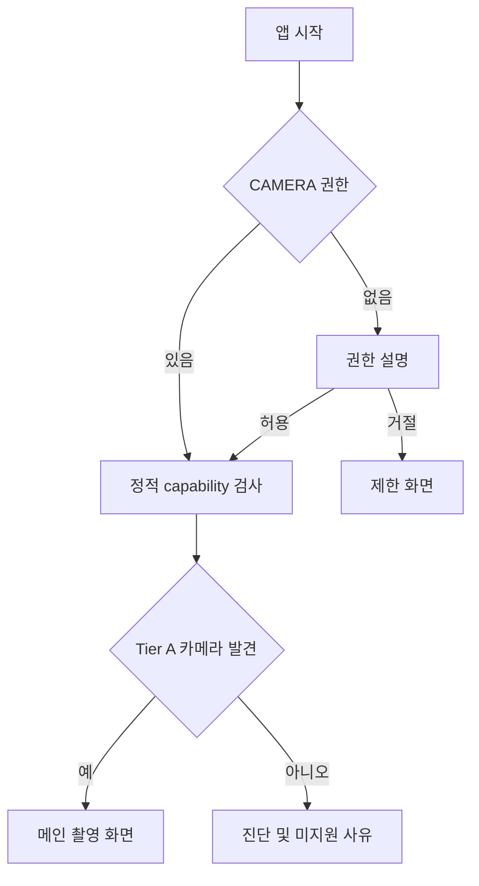
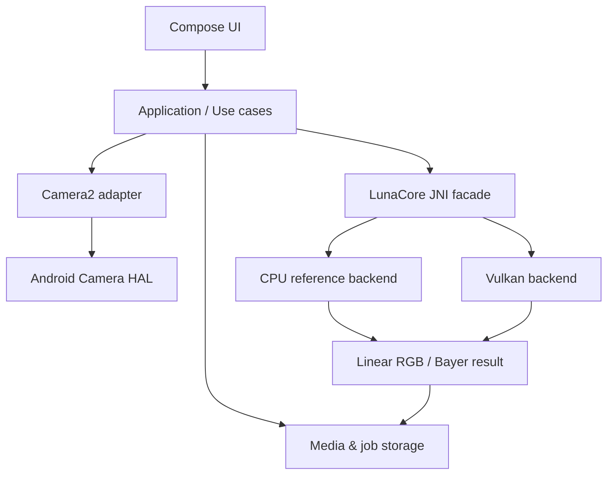
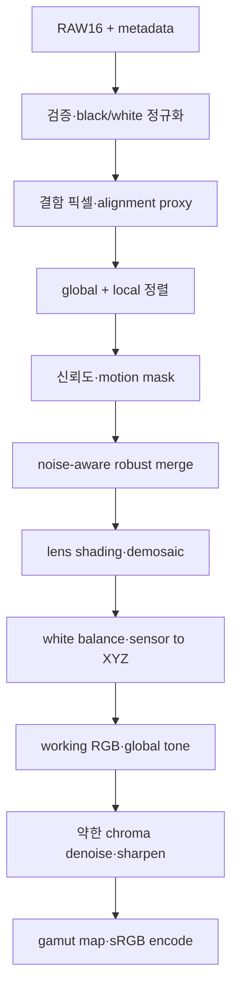

# LunaCam 계산사진 카메라 — Codex 구현 설계 명세

> 0.7.0: 사용자가 지연 기준을 **다음 촬영 접수까지 1.2초**로 정정했다. 촬영과 처리를 분리하고
> 새 촬영은 결과 한 장만 공개 저장한다. AUTO HDR 상세는 `PHOTON_AUTO_HDR.md`, 검증은
> `PHOTON_AUTO_VERIFICATION.md`가 우선한다. 이전 원본+결과 공개 정책은 새 촬영에 적용하지 않는다.

> 0.6.0 추가: 사용자 요청으로 JPEG 질감 보호의 수식은 유지한 채 네이티브 실행으로 옮기고,
> 별도 Camera2 RAW 1장/3장 촬영 및 보존 우선 Bayer 합성을 구현했다. 현재 구현 범위는
> `PHOTON_RAW_ALGORITHM.md`, 실제 근거와 남은 검증은 `PHOTON_RAW_VERIFICATION.md`가 우선한다.
> 아래 전체 RAW 연구 명세의 모든 항목이 완성됐다는 의미는 아니다.

> 0.5.0 추가: 자연스러운 질감·과보정 억제라는 사용자 선택을 반영한 저장 사진용
> PHOTON 질감 보호 실험과 핀치 줌을 추가한다. 앱 후처리 OFF와 제조사 ISP 비활성화는
> 서로 다른 의미다. 세부 수식/한계는 `PHOTON_TEXTURE_ALGORITHM.md`, 근거는
> `PHOTON_TEXTURE_VERIFICATION.md`를 참조한다. 기존 RAW 연구 경로는 교체하지 않는다.

> 2026-10-23 추가: 사용자 요청의 LUNA PHOTON 인계서에 따라 일반 촬영 CameraX 경로를
> 증축했다. 기존 Camera2/RAW 연구 경로의 설계는 보존한다. 이 문서의 P2 무촬영 제한과
> 단계 명칭은 기존 경로에 적용되며 새 AUTO 경로에는 `PHOTON_SPRINT1.md`가 우선한다.
> 새 진단 JSON은 기존 리포트를 교체하지 않는 별도 계약이다. 실제 검증 범위는
> `PHOTON_VERIFICATION.md`를 참조한다.

> 문서 상태: 구현 기준선(Baseline Specification) 0.1  
> 작성 기준일: 2026-09-01  
> 1차 타깃: Samsung Galaxy S25 Ultra, Android 15 이상  
> 공개 앱 이름: **LunaCam Lab**(가칭)  
> 내부 엔진 이름: **LunaCore**(가칭)  
> 독자: Codex 구현 에이전트, 프로젝트 소유자, 계산사진 알고리즘 개발자  
> 문서 언어: 요구사항은 한국어, 코드 식별자와 데이터 계약은 영어

---

## 0. 이 문서를 사용하는 방법

이 문서는 아이디어 메모가 아니라 구현 계약이다. Codex는 저장소를 만들거나 변경할 때 이 문서를 최상위 제품·기술 명세로 취급해야 한다. 다만 실제 Android SDK가 반환하는 런타임 capability, 컴파일러 오류, 공식 API 계약은 이 문서의 추측보다 우선한다.

규칙의 우선순위는 다음과 같다.

1. 사용자의 현재 명시적 지시
2. 실제 기기에서 읽은 `CameraCharacteristics`, 세션 구성 결과, 캡처 결과
3. Android 공식 API 계약과 빌드 도구가 검증한 사실
4. 이 문서의 MUST/SHOULD/MAY 규칙
5. 구현 편의상 세운 가정

이 문서에서 사용하는 요구 수준은 다음과 같다.

- **MUST**: 지키지 않으면 기능 또는 데이터 안전성이 깨지는 필수 조건
- **MUST NOT**: 절대 허용하지 않는 동작
- **SHOULD**: 특별한 근거가 없으면 지켜야 하는 권고
- **MAY**: 구현자가 선택할 수 있는 옵션

Codex는 API나 기기 기능을 기억에 의존해 만들어내지 않는다. 메서드·상수·지원 포맷이 불명확하면 현재 compile SDK의 공식 정의를 확인한다. 제조사 비공개 API, reflection으로 숨은 API를 호출하는 코드, 루트 권한, Shizuku, Samsung 전용 privileged 권한은 별도 사용자 승인과 별도 ADR 없이는 도입하지 않는다.

### 0.1 구현 중 문서 갱신 규칙

다음 사실이 발견되면 같은 변경 묶음에서 이 문서 또는 `docs/decisions/`의 ADR을 갱신해야 한다.

- S25 Ultra가 실제로 노출한 camera ID, physical camera ID, RAW 크기, 버스트 속도
- 지원된다고 보고된 스트림 조합이 실제 세션 생성에서 실패한 경우
- 결과 품질이나 메모리 때문에 기본 프레임 수·출력 크기를 바꾼 경우
- CPU 기준 구현의 수식 또는 색 처리 순서를 바꾼 경우
- 파일 포맷, DB 스키마, JNI ABI를 바꾼 경우
- 이 문서의 완료 조건을 우회하거나 범위를 줄인 경우

문서와 코드가 충돌한 상태를 조용히 남기지 않는다. 아직 답이 없는 항목은 `[OPEN]`, 실기기 검증이 필요한 항목은 `[DEVICE-VERIFY]`, 이후 버전 항목은 `[DEFERRED]`로 표시한다.

---

## 1. 한 문장 목표와 제품 철학

**Galaxy S25 Ultra의 공개 Camera2 RAW 출력을 이용해 여러 장을 정렬·강건 병합하고, 과도한 밝기 상승·평탄화·노이즈 제거·샤픈을 피한 자연스러운 JPEG와 장기적으로 계산 RAW를 만드는 오프라인 계산사진 카메라를 구현한다.**

Project Indigo에서 가져오는 것은 브랜드나 비공개 구현이 아니라 아래의 공개된 제품 철학이다.

- 하이라이트를 보호하도록 보수적으로 노출한다.
- 한 장이 아니라 여러 RAW 프레임의 실제 관측값을 합친다.
- 다중 프레임 신호 덕분에 공간적 뭉개기와 과도한 샤픈을 줄인다.
- 로컬 톤 매핑으로 모든 밝기를 억지로 평평하게 만들지 않는다.
- 사용자가 프레임 수, 노출, 초점, 색온도, 처리 강도를 이해하고 조절할 수 있다.
- 확대 시 생성형 AI가 내용을 상상하는 대신 프레임 간 실제 서브픽셀 관측을 활용한다.

Adobe가 설명한 Indigo는 강한 언더노출, 최대 32프레임 정렬·병합, 거의 RAW 상태의 병합 결과, 약한 톤 매핑·샤픈을 핵심으로 삼는다. LunaCam은 이를 Android 공개 API 범위 안에서 독립적으로 재설계한다. 코드·UI·이름·색 프로파일을 복제하지 않으며 Adobe와 무관한 독립 프로젝트임을 README에 명시한다.

### 1.1 자연스러운 룩의 운영 정의

“자연스러움”을 감성 표현으로만 두지 않는다. 기본 `Natural` 룩은 다음 제약을 만족해야 한다.

- 중간 회색과 피부를 무조건 밝게 끌어올리지 않는다.
- 밝은 창과 조명 주변의 하이라이트 롤오프가 연속적이어야 한다.
- 암부에 약간의 미세 노이즈가 남는 것을 실패로 취급하지 않는다.
- 미세 질감의 국소 대비를 노이즈 제거로 지워버리지 않는다.
- 샤픈 halo와 이중 윤곽이 200% 확대에서 눈에 띄지 않아야 한다.
- 채도는 scene content나 얼굴 인식에 따라 몰래 크게 바뀌지 않는다.
- 의미론적 얼굴 미백, 하늘 파랗게 만들기, 피부 보정은 v0.x 범위에서 하지 않는다.
- 동일 조명·노출의 회색 카드가 장면 내용에 따라 다른 색으로 흔들리지 않아야 한다.

### 1.2 사용자가 얻는 고유 가치

LunaCam은 기본 카메라의 완전한 대체품이 아니라 “계산사진 연구실”이다.

1. **Natural Photo**: 버튼 하나로 다중 RAW 병합 사진을 얻는다.
2. **Transparent Capture**: 사용된 렌즈, 실제 프레임 수, 탈락 프레임, ISO, 노출, 처리 시간을 볼 수 있다.
3. **Lab Controls**: 병합 강도와 프레임 수를 조절하고 A/B 비교할 수 있다.
4. **Computational Negative**: 장기적으로 다중 프레임의 이점을 가진 편집 가능한 DNG를 제공한다.
5. **Truthful Fallback**: 기기가 기능을 막으면 가짜 RAW/가짜 24MP라고 표기하지 않고 정확히 제한을 알린다.

---

## 2. 범위

### 2.1 v0.1의 필수 범위

v0.1은 다음 수직 슬라이스를 완성한다.

1. CAMERA 권한 온보딩
2. 모든 camera ID의 정적 capability 수집 및 진단 리포트 내보내기
3. S25 Ultra 후면 메인 카메라의 안정적인 프리뷰
4. 탭 초점, 핀치 줌이 아닌 1× 메인 렌즈 고정, EV 보정
5. 자동 노출·초점·화이트밸런스 수렴 후 값을 동결한 RAW 8프레임 버스트
6. 타임스탬프로 `Image`와 `TotalCaptureResult`를 정확히 매칭
7. 8프레임 중 유효 프레임을 정렬하고 강건 병합
8. 디모자이싱, 카메라 색 변환, 약한 글로벌 톤 매핑, 약한 샤픈
9. sRGB SDR JPEG 저장
10. 결과 화면에서 단일 기준 프레임과 병합 결과 A/B 비교
11. 캡처 실패·일부 프레임 손실·메모리 부족·발열·저장공간 부족의 명시적 처리
12. CPU 기준 엔진과 자동화된 합성 RAW 테스트

“8프레임”은 사용자 약속이 아니라 기본 요청치다. 실제 캡처 결과가 5~7장만 유효해도 품질 기준을 만족하면 부분 성공할 수 있으며, UI에는 실제 병합 수를 표시한다. 4장 미만이면 병합 성공으로 위장하지 않고 단일 프레임 폴백 또는 실패 정책을 따른다.

### 2.2 v0.1에서 명시적으로 제외

- 0.6×, 3×, 5× 렌즈의 제품 수준 지원
- 24MP 출력 보장
- 50MP/200MP RAW 보장
- 16/32프레임 기본 촬영
- ZSL RAW 링 버퍼
- Night 모드 장노출 스택
- 노출 브라케팅 HDR
- 다중 프레임 초해상도(MFSR)
- 계산 DNG
- Ultra HDR 이득 지도 JPEG
- 영상, 라이브 포토, 모션 포토
- 인물 모드, 깊이 추정, 보케
- 생성형 AI 보정
- 클라우드 처리, 계정, 동기화
- 백그라운드 카메라 촬영
- Samsung 비공개 Camera HAL/ISP 호출

제외 기능의 UI를 회색 토글로 미리 만들어두지 않는다. 제품에 들어온 것처럼 보이는 죽은 UI는 만들지 않는다. 진단 화면에서 capability 정보만 보여주는 것은 허용한다.

### 2.3 장기 로드맵

| 버전 | 핵심 목표 | 출시 조건 |
|---|---|---|
| v0.1 | 메인 렌즈 RAW 8장 → 자연스러운 SDR JPEG | 정적 장면·손떨림 장면에서 단일 RAW 대비 노이즈 개선, 크래시 없는 50회 연속 테스트 |
| v0.2 | local motion rejection와 ghost suppression | 움직이는 사람·나뭇잎에서 이중상이 기준 이하 |
| v0.3 | Vulkan 가속 백엔드 | CPU 기준과 허용 오차 내 동일, GPU 오류 시 CPU 폴백 |
| v0.4 | 16/32프레임 적응형 Photo/Night | 발열·메모리·흔들림에 따른 프레임 수 자동 조절 |
| v0.5 | Computational DNG 실험 | Lightroom/ACR 및 최소 2개 독립 DNG 리더 호환 검증 |
| v0.6 | 노출 브라케팅 HDR | 움직임이 있는 HDR에서 안정적인 reference 선택·deghost |
| v0.7 | MFSR 및 진짜 24MP 모드 | 합성 차트에서 단순 업스케일 대비 실측 해상도 향상 |
| v0.8 | 0.6×/3×/5× 렌즈별 프로파일 | 각 렌즈 색·왜곡·shading 검증 완료 |
| v0.9 | Ultra HDR JPEG/HEIC | SDR 폴백과 HDR gain map 표시 검증 |
| v1.0 | 안정화·접근성·배포 | 데이터 손실 0, 지원표·개인정보·라이선스 완료 |

---

## 3. 플랫폼 기준선과 진실의 원천

### 3.1 빌드 기준선

- `minSdk = 35`: Galaxy S25 Ultra의 출고 플랫폼인 Android 15를 기준으로 한다.
- `compileSdk = 36`, `targetSdk = 36`: Android 16 API 계약을 사용한다.
- ABI는 v0.x에서 `arm64-v8a`만 패키징한다.
- Kotlin + Jetpack Compose로 UI를 구현한다.
- CameraX 캡처 파이프라인을 사용하지 않고 Camera2를 직접 사용한다.
- 네이티브 계산 엔진은 C++20 + CMake + Android NDK로 빌드한다.
- GPU 백엔드는 Vulkan compute이며 v0.1에서는 선택적 실험 기능이다.
- release 빌드에는 Vulkan validation layer를 포함하지 않는다.
- 도구 버전은 Gradle version catalog에 정확히 pin한다. `+`, `latest.release`, 부동 버전을 금지한다.

최신 안정 도구 버전은 저장소를 실제 생성하는 날 한 번 확인해 pin한다. 이 문서에 미래의 AGP/Kotlin/NDK patch 버전을 추측해 박지 않는다.

### 3.2 S25 Ultra 공개 하드웨어와 앱이 실제로 믿어야 할 것

Samsung의 공개 사양에는 후면 200MP wide, 50MP ultra-wide, 50MP 5× telephoto, 10MP 3× telephoto가 적혀 있다. 이 숫자는 제품 마케팅·하드웨어 사양이지 서드파티 Camera2 앱에 동일한 RAW 크기와 모든 physical camera가 노출된다는 약속이 아니다.

앱이 믿을 수 있는 것은 오직 다음이다.

- `CameraManager.cameraIdList`
- 각 ID의 `CameraCharacteristics`
- `REQUEST_AVAILABLE_CAPABILITIES`
- `SCALER_STREAM_CONFIGURATION_MAP`과 실제 `ImageReader` 출력 크기
- `getPhysicalCameraIds()`와 physical request key
- `INFO_SUPPORTED_HARDWARE_LEVEL`
- 실제 `createCaptureSession` 성공/실패
- 실제 캡처에서 돌아온 `TotalCaptureResult` 및 `Image`
- 런타임 벤치마크로 측정한 frame duration, stall, 메모리, 처리 시간

**MUST NOT:** `cameraId == "0"`이면 메인 렌즈라고 가정하지 않는다. 200MP 센서이므로 200MP RAW가 된다고 가정하지 않는다. 5× 버튼이 보인다는 이유로 5× RAW를 지원한다고 가정하지 않는다.

### 3.3 지원 등급

카메라별 지원 수준을 다음과 같이 계산한다.

| Tier | 필요 조건 | 제공 기능 |
|---|---|---|
| A | `RAW` + `BURST_CAPTURE` + `MANUAL_SENSOR`, 유효한 RAW 크기, preview+RAW 세션 성공 | 전체 v0.1 계산사진 |
| B | `RAW`, 세션 성공, burst/manual 일부 미지원 | 단일 RAW 또는 느린 제한 버스트, 실험 표시 |
| C | YUV/JPEG만 가능 | 프리뷰·진단; 계산 RAW 기능 비활성 |
| U | 카메라 열기/세션 구성 불가 또는 필수 metadata 불완전 | 미지원 사유만 표시 |

정적 metadata가 Tier A로 보이더라도 dynamic probe가 실패하면 실제 tier를 낮춘다. 한 번의 일시적 `CAMERA_IN_USE`는 capability 실패로 캐시하지 않는다.

### 3.4 Capability cache 무효화

진단 결과는 저장소 인스턴스의 메모리에서만 재사용한다. 기기·펌웨어 식별값으로 키를 만들거나 디스크에 진단 캐시를 저장하지 않는다. 앱을 다시 시작하면 새로 조회한다.

다음 상황에는 dynamic probe를 다시 수행한다.

- 앱 또는 진단 저장소 인스턴스 재시작
- 앱 capability schema 변경
- 사용자가 진단 화면에서 “다시 검사” 선택
- 이전 결과가 `TRANSIENT_FAILURE`
- 연속 3회의 정상 캡처에서 세션/포맷 관련 오류 발생

---

## 4. 제품 요구사항

### 4.1 기능 요구사항

#### 권한·온보딩

- **FR-PERM-001** 앱은 필요한 순간에만 `CAMERA` 런타임 권한을 요청한다.
- **FR-PERM-002** 사용자가 거절하면 빈 검은 프리뷰 대신 권한이 필요한 이유와 설정 이동 버튼을 보여준다.
- **FR-PERM-003** 위치 태그는 v0.1에서 기본 비활성이고 위치 권한을 요청하지 않는다.
- **FR-PERM-004** 앱이 만든 사진 저장에는 불필요한 전체 사진 라이브러리 권한을 요청하지 않는다.
- **FR-PERM-005** 권한이 자동 초기화되거나 설정에서 회수되면 다음 resume에서 다시 상태를 확인한다.

#### 카메라 탐색·진단

- **FR-CAP-001** 권한 획득 후 모든 카메라의 공개 characteristics를 안전하게 열거한다.
- **FR-CAP-002** 각 카메라에 대해 렌즈 방향, 초점거리, sensor size, active array, CFA, RAW 포맷·크기, exposure/ISO range, capabilities, physical IDs, 최소 frame duration, stall duration을 기록한다.
- **FR-CAP-003** 누락 가능한 key를 모두 nullable로 취급하고 누락 목록을 기록한다.
- **FR-CAP-004** 지원 후보 스트림 조합을 실제로 구성하되 사용자가 진단을 실행했거나 첫 촬영 준비 중일 때만 수행한다.
- **FR-CAP-005** 진단 리포트는 JSON과 사람이 읽는 Markdown 요약으로 내보낼 수 있다.
- **FR-CAP-006** 진단 내보내기에는 Android ID, 계정, 파일 경로, 위치, 사진 픽셀을 포함하지 않는다.

#### 프리뷰·조작

- **FR-PRV-001** 프리뷰는 화면 비율이 달라도 찌그러지지 않는다.
- **FR-PRV-002** sensor orientation, display rotation, 전면 카메라 미러링 여부를 분리하여 처리한다.
- **FR-PRV-003** v0.1은 후면 메인 렌즈 1×만 제품 기능으로 노출한다.
- **FR-PRV-004** 사용자가 탭한 화면 좌표를 sensor active array의 metering rectangle로 정확히 변환한다.
- **FR-PRV-005** focus 영역은 화면 밖으로 clamp하고 최소 유효 크기를 보장한다.
- **FR-PRV-006** EV 보정은 기기가 광고한 compensation range와 step에 맞춰 양자화한다.
- **FR-PRV-007** capture 진행 중 중복 shutter 입력은 새 버스트를 시작하지 않는다.
- **FR-PRV-008** volume key shutter는 설정으로 켜고 끌 수 있다.

#### 캡처 계획

- **FR-CAPTURE-001** shutter 전에 저장 공간, 메모리 budget, thermal status, camera state를 점검한다.
- **FR-CAPTURE-002** 자동 모드에서는 AE/AWB/AF의 최신 안정 결과를 snapshot한다.
- **FR-CAPTURE-003** 버스트 중 frame-to-frame 노출·ISO·focus가 의도치 않게 흔들리지 않도록 manual request로 고정한다.
- **FR-CAPTURE-004** 자동 기준보다 기본 `-1.0 EV`에 가까운 하이라이트 보호 노출을 계산하되 exposure/ISO/frame duration 범위를 지킨다.
- **FR-CAPTURE-005** 노출을 줄일 때 우선순위는 장면·흔들림 조건에 따라 shutter와 ISO를 결정론적으로 조정한다.
- **FR-CAPTURE-006** 각 request에는 job ID와 frame index를 tag로 단다.
- **FR-CAPTURE-007** `Image.timestamp`와 `CaptureResult.SENSOR_TIMESTAMP`가 같은 프레임끼리 매칭되어야 한다.
- **FR-CAPTURE-008** 프레임 하나의 metadata가 없으면 그 프레임을 조용히 임의 metadata에 붙이지 않는다.
- **FR-CAPTURE-009** capture timeout 후 세션을 무조건 파괴하지 말고 먼저 pending request 정리와 프리뷰 복구를 시도한다.
- **FR-CAPTURE-010** 취소 시 이미 저장된 최종 사진은 지우지 않고, 아직 publish되지 않은 임시 자원만 정리한다.

#### 처리

- **FR-PROC-001** 원시 행 stride와 실제 width를 구분하여 읽는다.
- **FR-PROC-002** CFA 패턴을 runtime metadata에서 읽고 RGGB 고정 가정을 금지한다.
- **FR-PROC-003** black level과 white level을 적용해 프레임을 scene-linear 정규화한다.
- **FR-PROC-004** 프레임별 노출·ISO 차이는 alignment/merge 전에 radiometric normalization한다.
- **FR-PROC-005** 정렬 신뢰도가 낮은 프레임은 가중치를 낮추거나 제외한다.
- **FR-PROC-006** 움직이는 영역은 reference frame을 우선해 ghost를 억제한다.
- **FR-PROC-007** 유효 프레임이 부족하면 명시된 부분 성공/폴백 규칙을 따른다.
- **FR-PROC-008** CPU backend가 수치적 기준 구현이다.
- **FR-PROC-009** Vulkan backend는 CPU 결과의 정해진 허용 오차를 통과해야 활성화한다.
- **FR-PROC-010** GPU 초기화·할당·dispatch·fence 실패는 앱 전체 크래시가 아니라 CPU 폴백 또는 작업 실패로 변환한다.
- **FR-PROC-011** 처리 recipe와 엔진 버전을 결과에 보존한다.

#### 저장·결과

- **FR-SAVE-001** 결과는 `MediaStore` pending item으로 원자적으로 publish한다.
- **FR-SAVE-002** 인코딩 실패나 프로세스 종료 시 0바이트/부분 파일이 갤러리에 정상 사진처럼 노출되지 않아야 한다.
- **FR-SAVE-003** v0.1 기본 출력은 sRGB SDR JPEG quality 95다.
- **FR-SAVE-004** EXIF에는 방향, 실제 대표 노출, ISO, focal length, 날짜, 소프트웨어, 사용자 설명을 가능한 범위에서 기록한다.
- **FR-SAVE-005** 다중 프레임 결과의 EXIF 노출은 reference frame 값을 사용하고 `ImageDescription`에 merged frame count를 기록한다.
- **FR-SAVE-006** 파일 이름 충돌은 overwrite하지 않고 단조 증가 suffix로 해결한다.
- **FR-SAVE-007** 저장 완료 후 최근 결과 썸네일과 A/B 비교 화면을 제공한다.
- **FR-SAVE-008** 사용자는 실패한 작업의 원인과 복구 가능 여부를 볼 수 있다.

### 4.2 비기능 요구사항

- **NFR-REL-001** 카메라·Image·buffer·file descriptor·Vulkan handle은 명확한 owner가 정확히 한 번 닫는다.
- **NFR-REL-002** 정상 상태에서 50회 연속 촬영 시 카메라 stall, native crash, FD 누수, 증가하는 메모리 추세가 없어야 한다.
- **NFR-DATA-001** 최종 파일 publish 전 오류가 발생해도 기존 사용자 사진은 수정·삭제하지 않는다.
- **NFR-PRIV-001** 앱은 네트워크 권한 없이 동작하는 것을 기본으로 한다.
- **NFR-PRIV-002** 로그에 픽셀·위치·사용자 파일 경로·고유 기기 식별자를 남기지 않는다.
- **NFR-PERF-001** 12MP 8프레임 기준 shutter 이후 JPEG publish p50 5초 이하, p95 9초 이하를 v0.1 목표로 한다. 초기 CPU debug 빌드는 예외다.
- **NFR-PERF-002** 프리뷰는 정상 온도에서 체감 30fps를 유지하고 처리 때문에 UI thread가 100ms 이상 block되지 않는다.
- **NFR-MEM-001** 캡처 전 예상 peak native+Java working set을 계산하고 안전 budget을 넘으면 프레임 수를 줄인다.
- **NFR-THERM-001** thermal `SEVERE` 이상에서 새 고부하 촬영을 제한하고, 진행 중 작업은 데이터 안전을 우선해 축소 또는 완료한다.
- **NFR-TEST-001** 알고리즘은 실제 카메라 없이 합성 Bayer fixture로 단위 테스트할 수 있어야 한다.
- **NFR-OBS-001** 각 capture job은 단계별 duration, frame acceptance, fallback 이유를 구조화된 trace로 남긴다.
- **NFR-A11Y-001** shutter와 핵심 조작은 TalkBack label, 최소 touch target, 색 외 상태 표시를 갖는다.
- **NFR-MAINT-001** Activity/Composable이 Camera2 객체나 JNI handle을 직접 소유하지 않는다.
- **NFR-MAINT-002** 단일 소스 파일 600줄 초과 시 책임 분리를 검토하고, 1,000줄 초과는 ADR 없는 한 금지한다.

---

## 5. 사용자 경험 설계

### 5.1 첫 실행



권한 설명은 “사진을 찍기 위해 카메라 접근이 필요함”만 말한다. 저장 권한이나 인터넷 권한을 묶어 요청하지 않는다. 영구 거절 상태에서는 반복 팝업을 띄우지 않고 시스템 설정 이동을 사용자가 누르게 한다.

### 5.2 메인 촬영 화면 v0.1

화면은 세 영역으로 구성한다.

1. 상단: 설정, RAW capability/thermal 경고, processing queue 표시
2. 중앙: edge-to-edge 프리뷰, focus indicator, 노출/히스토그램 선택 표시
3. 하단: 최근 결과, `Natural` 룩, shutter, 프레임 수, EV

기본 표시 예:

```text
┌────────────────────────────┐
│ ⚙  RAW 8   1×   24°C  INFO │
│                            │
│          preview           │
│             □ AF           │
│                            │
│       EV -1.0              │
├────────────────────────────┤
│ [last]  Natural   (●)  8F  │
└────────────────────────────┘
```

(P2에서 확정) 중앙 프리뷰는 **edge-to-edge가 아니라 센서 active array 종횡비 그대로 letterbox fit** 한다. S25 Ultra 실측에서 화면 종횡비(2.167) 기준으로 preview size를 고르면 4:3 센서에서 2.33:1 판독(1920×824)이 선택되어 수직 화각의 43%가 사라졌다. 그러면 뷰파인더와 P3 RAW(4:3) 촬영 결과의 프레이밍이 달라진다. RAW 카메라에서는 "보이는 것 = 찍히는 것"이 edge-to-edge보다 우선하므로, 긴 화면에서는 상하(가로 화면에서는 좌우) 검은 띠를 허용한다. 구현은 `PreviewSizeSelector`(센서 종횡비로 선택)와 `PreviewTransformFactory`(fit, crop 아님)에 있다.

`24°C`처럼 실제 센서 온도를 얻는다고 가정하지 않는다. Android thermal API는 상태/헤드룸으로 표현하고 UI는 `정상`, `따뜻함`, `뜨거움`처럼 표시한다. 위 텍스트는 레이아웃 예일 뿐이다.

### 5.3 shutter 동작

상태별 동작은 다음과 같다.

| 현재 상태 | 탭 결과 |
|---|---|
| PreviewReady | preflight 후 capture 시작 |
| FocusSettling | 최대 제한 시간까지 기다린 뒤 현재 focus로 capture |
| Capturing | 무시 + 짧은 haptic; 중복 job 생성 금지 |
| Processing | v0.1은 새 capture 금지; 진행률 표시 |
| Saving | v0.1은 새 capture 금지 |
| ThermalBlocked | 이유와 예상 복구 조건 표시 |
| LowStorage | 저장공간 확보 안내 |
| CameraRecovering | 복구 중 표시, 입력 무시 |
| PermissionMissing | 권한 안내 |

v0.1은 처리 중 연속 촬영 queue를 지원하지 않는다. queue를 어설프게 열어 RAM을 폭증시키는 것보다 한 작업 완료 후 다음 촬영을 허용한다. v0.3 이후 queue depth 1을 별도 설계할 수 있다.

### 5.4 촬영 진행 상태

진행률은 가짜 선형 percent 하나로 속이지 않는다. 단계명을 표시한다.

```text
빛 측정 중 → RAW 3/8 → 정렬 중 → 병합 중 → 색 처리 중 → 저장 중
```

프레임 캡처 단계에서는 실제 수신 프레임 수를 표시한다. 처리 단계의 percent는 엔진이 tile 완료량을 보고할 수 있을 때만 사용한다. 취소 가능한 단계와 취소 불가능한 atomic publish 구간을 구분한다.

### 5.5 결과와 A/B

결과 화면은 다음을 제공한다.

- 최종 merged JPEG
- reference frame을 동일 렌더 파이프라인으로 처리한 single-frame 비교
- 길게 누르면 single, 놓으면 merged
- 실제 사용 프레임 `6/8` 표시
- 총 처리 시간과 backend `CPU`/`Vulkan`
- 제외 프레임 수와 간단한 이유: blur 1, alignment 1
- 공유, 삭제, 상세 recipe 보기

“원본”이라는 표현은 모호하므로 single reference를 `기준 1장`, merged를 `다중 프레임`으로 표기한다.

### 5.6 화면 회전·멀티윈도우·백그라운드

- 화면 회전만으로 진행 중 capture/processing job을 취소하지 않는다.
- camera owner는 activity recreation보다 긴 `ViewModel`/application-scoped coordinator에 두되 화면이 실제 background로 가면 새 카메라 frame을 멈춘다.
- `onStop` 시 아직 **Capturing**이면 가능한 빨리 burst를 종료하고 수신한 프레임으로 부분 처리 여부를 판단한다.
- **Processing/Saving**은 카메라를 닫은 뒤 foreground UI 없이 짧게 완료할 수 있다. 장시간 background service로 확장하지 않는다.
- multi-window에서 activity가 paused 되었고 다른 앱이 카메라를 필요로 할 수 있으므로 preview camera를 해제한다.
- PiP는 v0.1에서 지원하지 않는다.
- 화면이 꺼지거나 기기가 잠기면 카메라를 닫고 unpublished 임시 작업을 journal에 기록한다.

---

## 6. 전체 아키텍처

### 6.1 계층



UI는 `CaptureUseCase`만 호출한다. Camera2 callback, native pointer, MediaStore URI publish 순서를 UI에 노출하지 않는다.

### 6.2 Gradle 모듈

```text
root/
├─ app/                         # Android entry point, composition root
├─ feature-camera/              # Compose camera screen and UI state
├─ feature-result/              # filmstrip, A/B, recipe detail
├─ feature-diagnostics/         # capability viewer/export
├─ domain/                      # pure Kotlin entities and use cases
├─ camera-camera2/              # Camera2 implementation
├─ processing-api/              # Kotlin-facing engine contracts
├─ processing-native/           # JNI packaging and CMake bridge
├─ storage-media/               # MediaStore, temp files, recovery journal
├─ observability/               # structured local traces, redaction
├─ test-fixtures/               # synthetic RAW and metadata fixtures
├─ benchmark/                   # macro/micro benchmarks
├─ docs/
│  ├─ DESIGN.md                 # 이 문서의 저장소 사본
│  ├─ ALGORITHM.md              # 구현 후 수식·파라미터 최신화
│  ├─ DEVICE_MATRIX.md          # 실기기 결과
│  └─ decisions/                # ADR
└─ native/
   └─ lunacore/
      ├─ include/lunacore/      # public C++ API
      ├─ src/core/              # ownership, job graph, common math
      ├─ src/raw/               # unpack, calibration, CFA
      ├─ src/alignment/         # pyramids, global/local alignment
      ├─ src/merge/             # noise model, robust merge
      ├─ src/demosaic/          # Bayer reconstruction
      ├─ src/color/             # WB, matrices, tone, gamut
      ├─ src/backend/cpu/       # scalar/NEON reference
      ├─ src/backend/vulkan/    # optional compute implementation
      ├─ shaders/               # GLSL compute source
      └─ tests/                 # host/native tests
```

`native/`를 Gradle 모듈 안에 중복 복사하지 않는다. 하나의 canonical source tree만 두고 `processing-native`가 CMake를 참조한다.

### 6.3 의존 방향

```text
feature-*  ──> domain <── camera-camera2
                    <── storage-media
                    <── processing-api <── processing-native
```

- `domain`은 Android framework type을 받지 않는다. `Uri`, `Image`, `CaptureResult`, `Bitmap` 금지.
- `camera-camera2`는 Compose에 의존하지 않는다.
- `processing-native`는 Camera2 객체를 알지 않는다. 평탄화된 metadata DTO만 받는다.
- `storage-media`는 native engine handle을 알지 않는다.
- app 모듈의 composition root만 concrete implementation을 연결한다.
- (P2에서 확정) `feature-camera`는 `domain`에 더해 `camera-camera2`에도 의존할 수 있다.
  preview surface 계약은 `android.view.Surface`를 다루므로 `domain`에 둘 수 없고, 위 금지 4개 항목은
  그대로 유지된다. `feature-camera`가 `camera-camera2`에서 사용하는 것은 `PreviewCameraController`,
  `PreviewSurfaceProvider`, `PreviewViewGeometry` 계약뿐이며 Camera2 객체를 직접 만지지 않는다.

### 6.4 수동 DI

v0.x에서는 Hilt 같은 코드 생성 DI 프레임워크를 넣지 않는다. `AppGraph`가 명시적으로 singleton과 factory를 만든다. 이유는 카메라·native 자원의 lifetime을 annotation 뒤에 숨기지 않고 테스트 대체를 쉽게 하기 위함이다.

```kotlin
interface AppGraph {
    val capabilityRepository: CapabilityRepository
    val cameraControllerFactory: CameraControllerFactory
    val captureCoordinator: CaptureCoordinator
    val processingEngine: ProcessingEngine
    val mediaRepository: MediaRepository
    val traceRepository: TraceRepository
}
```

### 6.5 thread와 dispatcher 계약

| 실행 문맥 | 담당 | 금지 |
|---|---|---|
| Main | Compose state, permission result, 짧은 orchestration | Camera callback 대량 복사, JPEG encode, JNI 장시간 호출 |
| CameraExecutor | CameraDevice/session/result callback 순서화 | 이미지 처리, 디스크 저장 |
| ImageIngestExecutor | `ImageReader` acquire → native pool copy → close | alignment/merge, UI callback 직접 호출 |
| ProcessingDispatcher | 단일 capture job의 CPU/GPU 처리 | Camera2 객체 접근 |
| IoDispatcher | temp, MediaStore, EXIF, diagnostics export | camera session 조작 |
| Native worker pool | tile alignment/merge/color | JNI로 임의 Java callback, UI 참조 |

Camera callback 순서를 보존하기 위해 camera executor는 single-thread다. Image ingest는 짧은 복사 전용 single-thread 또는 우선순위 높은 제한 executor로 시작한다. 같은 capture job 내부에서 무제한 coroutine을 만들지 않는다.

### 6.6 자원 소유권 원칙

- `CameraDeviceOwner`만 `CameraDevice.close()`를 호출한다.
- `SessionOwner`만 현재 `CameraCaptureSession`을 닫고 교체한다.
- `RawImageReaderOwner`만 `ImageReader`를 닫는다.
- `OnImageAvailableListener`가 acquire한 `Image`는 같은 callback scope의 `finally`에서 닫는다.
- native `FramePool`은 복사된 bytes를 소유하며 Java `Image` lifetime에 의존하지 않는다.
- `ProcessingJobHandle`은 `AutoCloseable`이며 성공·실패·취소 모두에서 release된다.
- `PendingMediaItem`만 pending URI를 publish 또는 rollback한다.
- Vulkan object는 dependency 순서의 역순으로 RAII 파괴한다.

Cleaner/finalizer는 안전망이지 정상 release 경로가 아니다.

---

## 7. 상태 머신

### 7.1 카메라 상태

```kotlin
sealed interface CameraState {
    data object Closed : CameraState
    data object PermissionRequired : CameraState
    data class Opening(val cameraKey: CameraKey) : CameraState
    data class Configuring(val profile: StreamProfile) : CameraState
    data class Previewing(val runtime: PreviewRuntime) : CameraState
    data class Capturing(val jobId: CaptureJobId, val received: Int, val expected: Int) : CameraState
    data class Recovering(val attempt: Int, val cause: CameraFailure) : CameraState
    data class Blocked(val cause: CameraFailure) : CameraState
    data object Closing : CameraState
}
```

허용 전이는 명시한다.

```text
Closed → Opening → Configuring → Previewing → Capturing → Previewing
   ↑          ↘ failure → Recovering ───────────────┘
   └──────────────────── Closing ← any recoverable active state
PermissionRequired → Opening (permission granted)
Blocked → Closed/Opening (user action or resource available)
```

오래된 callback이 새 state를 덮어쓰지 않도록 모든 open/session generation에 증가하는 `generationId`를 부여한다. callback은 자신의 generation이 현재와 다르면 자원만 닫고 state를 변경하지 않는다.

### 7.2 촬영 작업 상태

```kotlin
sealed interface CaptureJobState {
    data object Created : CaptureJobState
    data object Preflight : CaptureJobState
    data object Metering : CaptureJobState
    data class Acquiring(val received: Int, val expected: Int) : CaptureJobState
    data class Pairing(val images: Int, val results: Int) : CaptureJobState
    data class Processing(val stage: ProcessingStage, val progress: Float?) : CaptureJobState
    data object Encoding : CaptureJobState
    data object Publishing : CaptureJobState
    data class Completed(val mediaId: MediaId) : CaptureJobState
    data class PartialSuccess(val mediaId: MediaId, val warnings: List<CaptureWarning>) : CaptureJobState
    data class Failed(val error: CaptureFailure) : CaptureJobState
    data class Cancelled(val stage: String) : CaptureJobState
}
```

`Publishing`에 들어간 뒤 MediaStore transaction이 시작되면 cancel은 publish/rollback의 원자적 결정을 기다린다. 취소 요청 때문에 pending item을 반쯤 남기지 않는다.

### 7.3 불변식

- active camera generation은 최대 하나다.
- active capture job은 최대 하나다.
- active processing job은 v0.1에서 최대 하나다.
- `Completed`/`PartialSuccess`는 유효하고 읽을 수 있는 media URI를 가진다.
- `Failed`/`Cancelled`는 공개 갤러리에 pending 결과를 남기지 않는다.
- 한 frame index에는 최대 하나의 image와 하나의 final result만 결합된다.
- timestamp가 없는 image는 임의 frame index에 순서로 끼워 넣지 않는다.

---

## 8. Capability discovery 상세

### 8.1 정적 probe 필드

각 camera ID에 대해 아래를 nullable-safe하게 수집한다.

```text
Identity
- cameraId
- lensFacing
- hardwareLevel
- capabilities[]
- physicalCameraIds[]
- logicalMultiCameraSyncType

Optics/Sensor
- focalLengths[]
- apertures[]
- minimumFocusDistance
- hyperfocalDistance
- sensorPhysicalSize
- pixelArraySize
- activeArraySize
- preCorrectionActiveArraySize
- sensorOrientation
- colorFilterArrangement
- whiteLevel
- blackLevelPattern
- maxAnalogSensitivity
- timestampSource
- lensShadingApplied

Control
- sensitivityRange
- exposureTimeRange
- maxFrameDuration
- aeCompensationRange
- aeCompensationStep
- afModes[]
- awbModes[]
- opticalStabilizationModes[]
- videoStabilizationModes[]
- availableRequestKeys[]
- availableResultKeys[]
- physicalRequestKeys[]

Streams
- outputFormats[]
- RAW_SENSOR sizes + minFrameDuration + stallDuration
- RAW10/RAW12/RAW_PRIVATE sizes (진단만; v0.1 미사용)
- YUV_420_888 sizes
- JPEG/JPEG_R sizes
- PRIVATE preview sizes
- recommended RAW/preview maps if present
- mandatory/recommended stream combinations if API exposes them
```

### 8.2 camera role 추정

“메인 후면” 선택은 다음 점수 기반으로 하되 결과를 진단에 남긴다.

1. `LENS_FACING_BACK` 필수
2. RAW capability 가산
3. focal length가 일반 wide 범위에 있고 sensor physical area가 큰 후보 가산
4. logical camera의 default wide 후보 가산
5. 실제 preview+RAW 세션 성공 가산
6. 초광각 또는 긴 망원으로 보이는 focal length 감점

동점이거나 확신이 낮으면 진단 화면에서 사용자가 후보를 선택할 수 있게 한다. 선택값은 현재 진단 세션에서만 유지한다. camera ID 문자열 자체를 렌즈 이름으로 사용자에게 노출하지 않는다.

### 8.3 RAW 크기 선택

v0.1은 “가장 큰 RAW”가 아니라 “8장 계산 촬영에 가장 적합한 RAW”를 선택한다.

선택 점수:

- 목표 면적: 약 12MP를 우선
- active array와 aspect ratio가 일치
- min frame duration이 짧음
- stall duration이 낮음
- 8프레임 예상 메모리가 budget 안
- dynamic burst probe 성공

50MP/200MP만 노출되고 메모리 budget을 넘으면 프레임 수를 줄이거나 Tier B로 낮춘다. 임의로 RAW를 crop/downscale한 뒤 “센서 RAW 12MP”라고 부르지 않는다.

### 8.4 dynamic probe 단계

Dynamic probe는 사용자에게 프리뷰가 보이는 동안 조용히 수십 장을 찍지 않는다. 다음과 같이 최소화한다.

1. 후보 카메라 열기
2. preview-only session 구성
3. preview + selected RAW session 구성
4. RAW 1장 capture, image/result match 검증
5. 사용자가 최초 계산사진을 요청했을 때 RAW 4장 burst 예비 검증
6. 실제 frame interval, missing callback, metadata completeness 기록
7. 정상일 때 8프레임 profile 활성화

probe RAW는 갤러리에 저장하지 않고 즉시 폐기한다. 카메라가 다른 앱에서 사용 중이면 dynamic probe를 실패로 영구 캐시하지 않는다.

### 8.5 stream profile fallback 순서

세션 구성 실패 시 다음 순서로 정확히 한 단계씩 낮춘다.

1. `PRIVATE preview ≤ 1920×1080 + RAW selected`
2. `PRIVATE preview ≤ 1280×720 + RAW selected`
3. `PRIVATE preview smallest acceptable + RAW selected`
4. `preview-only`, RAW capture 때 세션 재구성
5. 등급 B 단일 RAW
6. 프리뷰 전용 등급 C

각 fallback은 최대 한 번만 시도하고 무한 재구성 loop를 금지한다. `onConfigureFailed`가 오면 같은 profile을 즉시 반복하지 않는다.

P2 구현에서 1~3단계는 `PreviewSizeTier`(`FULL_HD` → `HD` → `SMALLEST`)로 표현한다. `PreviewSizeSelector.nextTier()`가 한 단계 하강을 결정하고, `CONFIGURE_FAILED` 복구가 이를 호출한 뒤 세션을 재구성한다. preview-only 세션만 구성하는 P2에서는 `HD` 등급이 `FULL_HD`의 부분집합이므로 최초 선택으로는 도달하지 않고, 오직 이 하강 경로에서만 선택된다. 4~6단계는 RAW 스트림이 생기는 P3 이후에 연결된다.

### 8.6 진단 JSON 개요

```json
{
  "schemaVersion": 2,
  "createdAtUtc": "2026-09-01T00:00:00Z",
  "cameras": [
    {
      "cameraId": "local-session-id",
      "roleGuess": "BACK_WIDE",
      "tier": "A",
      "missingKeys": [],
      "rawProfiles": [],
      "dynamicProbe": {
        "status": "SUCCESS",
        "streamProfile": "preview720_raw12mp",
        "observedFrameIntervalNsP50": 0
      }
    }
  ]
}
```

진단 스키마 2는 기기 요약과 기기에서 파생한 캐시 키를 포함하지 않는다. 모델 코드, 제조사, 기기 SDK, 펌웨어 식별값과 그 해시를 수집·내보내지 않는다.

---

## 9. Camera2 세션·캡처 설계

### 9.1 프리뷰 surface

Compose 안에 `AndroidView`로 `SurfaceView`를 호스팅한다. `TextureView`의 편리함보다 불필요한 추가 합성·복사 가능성을 줄이고 명시적인 buffer size/transform을 갖기 위해 `SurfaceView`를 기본으로 한다. 특정 기기에서 transform 제어가 충분하지 않으면 ADR로 `TextureView` 또는 Camera Viewfinder library를 검토한다.

프리뷰 좌표계는 반드시 구분한다.

1. view 좌표
2. display-rotated preview buffer 좌표
3. sensor active array 좌표
4. crop region 좌표

하나의 `PreviewTransform`이 정방향·역방향 matrix를 모두 제공한다.

```kotlin
data class PreviewTransform(
    val sensorToView: Matrix3x3,
    val viewToSensor: Matrix3x3,
    val visibleSensorRect: IntRect,
    val bufferSize: IntSize,
    val displayRotationDegrees: Int,
    val sensorOrientationDegrees: Int,
    val mirrored: Boolean,
)
```

matrix invert 실패, 0 크기 surface, layout 전 tap은 무시하고 사용자에게 오류를 띄우지 않는다. surface size가 안정된 뒤 session을 구성한다.

(P2에서 추가) `PreviewTransform`은 계산만 하고 끝내면 안 된다. 계산한 결과를 실제 뷰 레이아웃에 적용하지 않으면 화면에 보이는 프레이밍과 탭 역변환이 서로 다른 가정을 쓰게 되고, 둘 다 맞을 수 없다. 따라서 `PreviewTransform`에 `displayedViewRect`(뷰 안에서 이미지가 실제로 차지하는 사각형)를 포함하고, `SurfaceView`는 반드시 그 종횡비로 레이아웃한다. letterbox 띠 위의 탭은 장면에 대한 탭이 아니므로 active array로 clamp하지 않고 **무시**한다.

### 9.2 기본 session output

v0.1 선호 구성:

```text
Output 1: SurfaceView / PRIVATE / preview size
Output 2: ImageReader / RAW_SENSOR / selected raw size / maxImages = adaptive
```

히스토그램용 YUV stream은 세 번째 stream이 session을 깨뜨리거나 RAW fps를 낮출 수 있으므로 v0.1 기본 세션에 넣지 않는다. 히스토그램은 추후 저해상도 YUV 동시 스트림 probe가 성공한 profile에서만 활성화한다.

RAW `ImageReader.maxImages`는 무조건 32로 만들지 않는다. 기본 8프레임에서 기기·메모리 probe를 바탕으로 10 이하를 우선한다. callback은 `acquireNextImage()`로 순서를 보존하고 즉시 native pool로 복사한 뒤 `Image.close()`한다. `acquireLatestImage()`는 버스트의 중간 프레임을 의도적으로 버릴 수 있으므로 RAW burst에 사용하지 않는다.

### 9.3 open/close 동기화

- `CameraDevice` open/close는 `Mutex`와 generation token으로 직렬화한다.
- 오래 걸리는 `openCamera()` callback을 기다리는 동안 main thread semaphore를 block하지 않는다.
- open timeout은 3초를 기본으로 하고, timeout 이후 도착한 `onOpened`는 즉시 close한다.
- `onDisconnected`는 사용자가 잘못한 것이 아닌 recoverable device event로 기록한다.
- `ERROR_CAMERA_DISABLED`는 관리자 정책 가능성을 알리고 자동 재시도하지 않는다.
- `ERROR_CAMERA_IN_USE`/`MAX_CAMERAS_IN_USE`는 짧은 backoff 후 사용자가 화면에 남아 있을 때 최대 2회 재시도한다.
- `ERROR_CAMERA_DEVICE`는 session 1회 재생성 후 camera reopen 1회만 시도한다.
- `ERROR_CAMERA_SERVICE`는 더 긴 복구가 필요하므로 자동 무한 반복하지 않고 앱 재실행 안내를 표시한다.

(P2에서 추가) 위 목록이 다루지 않는 세 경우의 복구 규칙을 다음과 같이 확정한다. 구현은 `RecoveryPolicy`이며 각 규칙에 JVM 테스트가 대응한다.

- `OPEN_TIMEOUT`(3초 open timeout 초과): camera reopen 1회만 시도하고 이후 차단한다.
- `CONFIGURE_FAILED`(`onConfigureFailed`): 8.5의 다음 tier로 한 단계 낮춰 session 1회만 재생성하고 이후 차단한다.
- `ACCESS_ERROR`(`CameraAccessException` 등 분류 불가한 프레임워크 거부): 짧은 backoff 후 reopen 1회만 시도하고 이후 차단한다.

모든 복구는 화면이 foreground일 때만 수행한다. 화면이 보이지 않으면 재시도 대신 즉시 차단하고 카메라를 해제한다. 재시도 예산은 camera generation 단위이며 프리뷰가 정상 시작되면 초기화된다.

### 9.4 3A 수렴과 측정 snapshot

자동 촬영은 다음 순서다.

1. preview repeating request에서 `CONTROL_MODE_AUTO`, 지원되는 continuous AF, AE/AWB auto 사용
2. 최근 결과 window에서 AE/AWB/AF 상태와 노출값 수집
3. shutter 시점에 tap focus가 진행 중이면 최대 600ms 대기
4. AE가 수렴하지 않아도 최대 800ms 후 최신 유효 측정값으로 진행
5. `SENSOR_EXPOSURE_TIME`, `SENSOR_SENSITIVITY`, `SENSOR_FRAME_DURATION`, `LENS_FOCUS_DISTANCE`, color correction 관련 결과를 snapshot
6. highlight protection recipe에 따라 target exposure 계산
7. 버스트 request에서 manual sensor capability가 있으면 AE off + 계산된 값 고정
8. AWB는 지원과 metadata 신뢰도에 따라 AWB lock 또는 manual color gains/transform을 사용

상태 상수 값이 null일 수 있다. `CONVERGED`만 영원히 기다리지 않는다. 일부 OEM은 state를 지속적으로 `SEARCHING` 또는 null로 보고할 수 있으므로 값의 시간적 안정성도 판단한다.

#### 안정성 판단 예

최근 5개 preview result에서 다음을 확인한다.

- exposure time 변화 ≤ 10%
- sensitivity 변화 ≤ 10%
- focus distance 변화 ≤ 허용 epsilon
- AE state가 converged/locked 또는 값 자체가 안정
- AWB state가 converged/locked 또는 gains 변화가 작음

### 9.5 하이라이트 보호 노출 계산

기본 목표는 preview AE가 선택한 총 노출량보다 1 EV 낮은 값이다.

```text
E_ref    = exposureTimeNs × sensitivity
E_target = E_ref × 2^(exposureBiasEv)
default exposureBiasEv = -1.0
```

이는 물리적 광량의 완전한 모델이 아니라 같은 카메라에서 request를 생성하기 위한 상대값이다. aperture가 고정이라는 전제도 characteristics로 확인한다.

값 배분 규칙:

1. 손떨림 위험을 줄이기 위한 `maxHandheldExposureNs`를 계산한다.
2. target shutter를 range 안에서 선택한다.
3. 남은 exposure product를 sensitivity에 배분한다.
4. ISO가 range 밖이면 shutter를 다시 조정한다.
5. `frameDuration >= exposureTime + sensorMargin`을 만족하고 광고된 max frame duration 이하로 clamp한다.
6. 최종 request 값과 실제 `TotalCaptureResult` 값을 모두 기록한다.

`maxHandheldExposureNs` 초기값은 메인 wide에서 약 1/30초지만 상수가 아니다. preview motion score, OIS 상태, focal length를 반영해 1/15~1/100초 사이에서 정한다. v0.1에서 센서 motion integration이 준비되지 않았으면 보수적으로 1/50초를 기본으로 한다.

### 9.6 request 생성

각 frame request는 `TEMPLATE_STILL_CAPTURE` 또는 기기 검증 결과 더 안정적인 template을 사용한다. 다음 key를 capability 확인 후 설정한다.

```text
CONTROL_MODE
CONTROL_AE_MODE / SENSOR_EXPOSURE_TIME / SENSOR_SENSITIVITY
SENSOR_FRAME_DURATION
CONTROL_AF_MODE / LENS_FOCUS_DISTANCE
CONTROL_AWB_MODE / CONTROL_AWB_LOCK
COLOR_CORRECTION_MODE / COLOR_CORRECTION_GAINS / COLOR_CORRECTION_TRANSFORM
LENS_OPTICAL_STABILIZATION_MODE
CONTROL_VIDEO_STABILIZATION_MODE = OFF
STATISTICS_LENS_SHADING_MAP_MODE = ON (지원 시 metadata 획득 목적)
NOISE_REDUCTION_MODE = OFF or MINIMAL (RAW에는 영향 없어야 하나 결과를 기록)
EDGE_MODE = OFF (동일)
SCALER_CROP_REGION
```

지원하지 않는 request key를 `set()`하면 안 된다. `availableCaptureRequestKeys`와 capability를 확인한다. vendor가 key를 광고했지만 `IllegalArgumentException`을 던지면 해당 key를 profile quirk에 기록하고 한 번 제거하여 재시도한다.

요청 태그:

```kotlin
data class BurstTag(
    val jobId: Long,
    val frameIndex: Int,
    val planRevision: Int,
)
```

### 9.7 callback와 프레임 매칭

Android는 같은 capture에서 나온 image buffer와 result에 동일한 sensor timestamp를 포함하도록 정의한다. 따라서 timestamp를 primary key로 사용한다.

```kotlin
data class PendingFrameParts(
    val timestampNs: Long,
    var imageToken: NativeFrameToken? = null,
    var result: FrameMetadata? = null,
    var requestIndex: Int? = null,
    var imageArrivedAtNs: Long? = null,
    var resultArrivedAtNs: Long? = null,
)
```

매칭 규칙:

- `Image.timestamp`가 0 또는 음수면 frame을 invalid 처리한다.
- final result의 `SENSOR_TIMESTAMP`가 null이면 그 result는 RAW 해석에 부적합하다.
- 동일 timestamp image가 두 번 오면 첫 번째 유효 frame만 유지하고 duplicate를 닫는다.
- 동일 timestamp final result가 두 번 오면 metadata equality를 검사하고 duplicate warning을 기록한다.
- partial result만 있고 final result가 timeout되면 그 frame은 사용하지 않는다.
- request tag index와 timestamp 순서가 충돌하면 timestamp match를 유지하되 diagnostic anomaly로 기록한다.
- image/result 도착 순서는 가정하지 않는다.
- 마지막 capture completed 후 `pairingGraceTimeout = max(1500ms, 3 × observedFrameInterval)` 동안 늦은 상대를 기다린다.
- failed request의 timestamp가 없으면 tag frame index를 failed set에 넣어 expected count를 낮춘다.

### 9.8 `Image` 입력 처리

callback의 필수 pseudocode:

```kotlin
override fun onImageAvailable(reader: ImageReader) {
    var image: Image? = null
    try {
        image = reader.acquireNextImage() ?: return
        if (!activeJob.accepts(image.timestamp)) return

        require(image.format == ImageFormat.RAW_SENSOR)
        val plane = image.planes.single()
        val token = nativeFramePool.copyRaw16(
            source = plane.buffer,
            rowStrideBytes = plane.rowStride,
            pixelStrideBytes = plane.pixelStride,
            width = image.width,
            height = image.height,
            timestampNs = image.timestamp,
        )
        activeJob.offerImage(image.timestamp, token)
    } catch (t: Throwable) {
        activeJob.offerIngestFailure(classify(t))
    } finally {
        image?.close()
    }
}
```

실제 코드에서 `require`가 callback thread를 죽이지 않도록 typed validation error로 바꾼다. `plane.buffer.remaining()`만 믿지 않고 `rowStride × height`와 마지막 유효 pixel offset을 검증한다. RAW_SENSOR pixel stride는 일반적으로 2지만 값과 byte order를 기록하고 검증한다. direct buffer 주소를 JNI가 callback 반환 이후 보관하지 않는다.

### 9.9 burst 중단과 부분 성공

다음 조건은 더 이상 frame을 받지 않는다.

- 사용자 cancel
- activity background + 정책상 capture 중지
- 카메라 연결 해제·오류
- 입력 대기열 초과
- 최종 시간 제한
- thermal emergency/shutdown 위험

이미 완성된 frame pair 수에 따라:

| 유효 pair | 결과 |
|---:|---|
| 0 | 실패 |
| 1~3 | 사용자가 설정에서 single fallback을 허용하면 reference JPEG, 아니면 실패 |
| 4~7 | reduced burst로 처리, partial success warning |
| 8 | 정상 처리 |

정렬 단계에서 추가 frame이 탈락해 최종 3장 이하가 되면 동일한 fallback 규칙을 적용한다.

### 9.10 프리뷰 복구

버스트 request가 끝난 뒤 repeating preview를 재개한다. manual capture key가 preview request에 남지 않도록 preview builder를 별도로 유지하거나 매번 immutable spec에서 재생성한다. capture builder를 preview builder로 재사용하지 않는다.

---

## 10. 핵심 데이터 계약

### 10.1 단위 규칙

- 시간: API 경계에서는 명시적으로 `Ns`, `Ms`, `UtcInstant` suffix 사용
- 감도: `iso`가 아니라 Camera2 `sensitivity`임을 문서화
- EV: `Double`, 1.0이 1 stop
- 색: scene-linear 값인지 encoded 값인지 type/name으로 구분
- 크기: pixel width/height
- 메모리: 바이트, `Long`
- matrix: row-major/column-major를 타입 정의에 고정; LunaCore는 row-major
- 사각형: 왼쪽·위 포함, 오른쪽·아래 제외

### 10.2 `CameraProfile`

```kotlin
data class CameraProfile(
    val key: CameraKey,
    val role: CameraRole,
    val tier: CapabilityTier,
    val hardwareLevel: HardwareLevel,
    val sensor: SensorProfile,
    val optics: OpticsProfile,
    val controls: ControlProfile,
    val streamProfiles: List<StreamProfile>,
    val quirks: Set<CameraQuirk>,
    val cacheKey: String,
)
```

### 10.3 `CapturePlan`

```kotlin
data class CapturePlan(
    val jobId: CaptureJobId,
    val cameraKey: CameraKey,
    val rawSize: IntSize,
    val requestedFrameCount: Int,
    val minimumMergeFrameCount: Int,
    val exposureBiasEv: Double,
    val exposureTimeNs: Long,
    val sensitivity: Int,
    val frameDurationNs: Long,
    val focusDistanceDiopters: Float?,
    val cropRegion: IntRect,
    val stabilization: StabilizationPlan,
    val output: OutputPlan,
    val recipe: ProcessingRecipe,
    val memoryEstimate: MemoryEstimate,
    val createdAt: Instant,
)
```

Plan은 immutable이다. thermal 변화 등으로 바뀌면 `planRevision + 1`의 새 plan을 만든다. 이미 제출한 request와 plan을 뒤에서 mutation하지 않는다.

### 10.4 `FrameMetadata`

```kotlin
data class FrameMetadata(
    val frameIndex: Int,
    val sensorTimestampNs: Long,
    val exposureTimeNs: Long,
    val sensitivity: Int,
    val frameDurationNs: Long?,
    val rollingShutterSkewNs: Long?,
    val focusDistanceDiopters: Float?,
    val focalLengthMm: Float?,
    val aperture: Float?,
    val neutralColorPoint: FloatArray?,
    val colorCorrectionGains: FloatArray?,
    val colorCorrectionTransform: RationalMatrix3x3?,
    val dynamicBlackLevel: FloatArray?,
    val dynamicWhiteLevel: Int?,
    val noiseProfile: DoubleArray?,
    val lensShadingMap: LensShadingMapDto?,
    val cropRegion: IntRect?,
    val sensorState: SensorStateSnapshot,
    val resultAnomalies: Set<MetadataAnomaly>,
)
```

배열 길이와 유한값을 native로 넘기기 전에 Kotlin과 C++ 양쪽에서 검증한다. NaN/Infinity/분모 0 rational은 missing으로 바꾼다.

### 10.5 `RawFrameDescriptor`

```cpp
enum class CfaPattern : uint8_t { RGGB, GRBG, GBRG, BGGR, MONO, UNKNOWN };

struct RawFrameDescriptor {
    uint32_t width;
    uint32_t height;
    uint32_t row_stride_bytes;
    uint32_t pixel_stride_bytes;
    CfaPattern cfa;
    uint64_t sensor_timestamp_ns;
    uint64_t exposure_time_ns;
    uint32_t sensitivity;
    std::array<float, 4> black_level;
    float white_level;
};
```

네이티브 pool 내부 canonical format은 little-endian unpacked unsigned 16-bit, tight logical pixels 또는 명시적 aligned stride로 통일한다. Camera buffer의 padding을 그대로 알고리즘 곳곳에 전파하지 않는다.

### 10.6 `ProcessingRecipe`

```kotlin
data class ProcessingRecipe(
    val schemaVersion: Int = 1,
    val alignment: AlignmentSettings,
    val merge: MergeSettings,
    val demosaic: DemosaicSettings,
    val color: ColorSettings,
    val tone: ToneSettings,
    val denoise: DenoiseSettings,
    val sharpen: SharpenSettings,
    val outputColorSpace: OutputColorSpace = OutputColorSpace.SRGB,
    val engineVersion: String,
)
```

recipe는 결과 재현을 위해 JSON 직렬화 가능해야 한다. float 기본값 변경 시 schema migration 또는 engine version에 따른 해석을 명시한다.

### 10.7 오류 분류

```kotlin
sealed interface CaptureFailure {
    val isRetryable: Boolean
    val userMessageKey: String
    val diagnosticCode: String
}
```

오류에는 사용자 메시지 문자열을 직접 넣지 않고 localization key와 diagnostic code를 분리한다. native 오류는 안정된 숫자 code + stage + safe detail로 매핑한다.

---

## 11. LunaCore 처리 파이프라인

### 11.1 파이프라인 순서



모든 단계는 입력·출력 color domain을 선언한다. “RGB float buffer” 하나로 scene-linear, display-linear, sRGB encoded를 뒤섞지 않는다.

### 11.2 단계 0 — 입력 검증

프레임별로 다음을 검사한다.

- width/height가 plan과 일치
- row stride가 마지막 pixel을 포함할 만큼 큼
- pixel stride가 지원값
- timestamp가 유일하고 양수
- exposure time, sensitivity, white level이 양수
- black level 각 channel이 finite하고 `0 <= black < white`
- CFA가 지원 패턴
- buffer size overflow 없는지 checked arithmetic
- 프레임 간 crop/size/CFA가 일치

하나의 metadata 오류 때문에 native process가 out-of-bounds 읽기를 해서는 안 된다. 잘못된 프레임만 탈락시킬 수 있는 오류와 job 전체가 불가능한 오류를 구분한다.

Job 전체 실패 예:

- reference frame의 CFA unknown
- 모든 프레임 white level invalid
- frame dimensions mismatch를 안전하게 crop할 정책 없음

개별 frame 제외 예:

- noise profile만 malformed
- 한 프레임 timestamp 중복
- 한 프레임 exposure metadata invalid

### 11.3 단계 1 — black/white 정규화

각 Bayer pixel `p`를 해당 CFA channel `c`의 black level로 보정한다.

```math
x = \operatorname{clamp}\left(\frac{p - b_c}{w - b_c}, 0, 1 + h\right)
```

- `b_c`: dynamic black level이 유효하면 frame별 값, 아니면 static black pattern
- `w`: dynamic white level이 유효하면 frame별 값, 아니면 static white level
- `h`: highlight headroom; 초기값 0.05, 실제 값이 white level을 약간 넘는 드라이버에 대한 수치 여유

clamp 전 음수 비율과 white clipping 비율을 diagnostics로 기록한다. 검은 영역이 광범위하게 0 아래라면 black level metadata 이상 가능성을 경고한다.

### 11.4 방사량 정규화

버스트 request가 고정이어도 실제 결과가 약간 달라질 수 있다. reference exposure product에 맞춘다.

```math
s_i = \frac{t_r \cdot ISO_r}{t_i \cdot ISO_i}
```

정규화 값 `x_i' = x_i × s_i`를 사용한다. ISO가 실제 gain과 정확히 선형이 아닐 수 있으므로 큰 차이의 bracket에는 별도 calibration이 필요하다. v0.1은 `s_i`가 [0.8, 1.25] 밖이면 해당 frame을 anomaly로 보고 낮은 가중치 또는 제외한다.

### 11.5 결함 픽셀 처리

정렬과 merge 전에 isolated hot/dead pixel이 motion estimator를 교란하지 않게 한다.

- 같은 CFA channel 이웃의 robust median과 크게 다른 isolated pixel 후보 검출
- saturation highlight cluster와 혼동하지 않도록 주변 gradient 확인
- alignment proxy에서만 median 대체
- 원본 raw merge에서는 여러 프레임 robust merge가 처리하도록 두되 모든 프레임 동일 위치 결함이면 보정
- 교정 좌표 수를 기록하고 과도하면 sensor/metadata anomaly

고정 불량화소 map은 향후 calibration 기능으로 분리한다.

### 11.6 정렬 proxy 생성

Bayer를 무작정 RGB로 완전 demosaic해 정렬하면 비용이 크고 demosaic artifact를 추적할 수 있다. 초기 proxy:

1. 각 2×2 CFA cell에서 두 green의 평균과 R/B 보조값을 얻음
2. green 중심 half-resolution luminance 생성
3. black/white와 exposure normalize
4. 약한 lens shading compensation을 proxy에만 적용 가능
5. 5×5 separable Gaussian으로 pyramid를 생성
6. gradient magnitude 또는 log-luma를 함께 계산

monochrome/비표준 CFA는 v0.1 미지원으로 tier를 낮춘다.

### 11.7 reference frame 선택

항상 첫 프레임을 reference로 쓰지 않는다. 각 frame에 점수를 계산한다.

```text
score =
  + sharpnessWeight × normalizedGradientEnergy
  - clippingWeight × clippedPixelRatio
  - motionWeight × gyroOrInterFrameMotion
  - metadataPenalty
  - temporalDistancePenaltyFromShutterMoment
```

사용자가 누른 순간에 가까운 frame을 선호하되 심하게 흔들렸다면 더 선명한 인접 frame을 선택한다. v0.1에서 gyro가 없으면 proxy 기반 blur/motion만 사용한다. reference index와 이유를 trace에 남긴다.

### 11.8 전역 정렬

초기 구현은 coarse-to-fine translation, 이후 small affine를 옵션으로 확장한다.

1. pyramid 최상위 level에서 phase correlation 또는 robust gradient SAD로 정수 translation 탐색
2. 아래 level로 displacement 확대
3. 작은 search window에서 subpixel refinement
4. correlation peak ratio와 residual로 confidence 계산
5. rotation/scale가 residual에 명확히 남고 feature 수가 충분하면 제한된 affine refinement

v0.1 기본 허용 범위:

- translation: full-resolution 기준 각 축 ±128px
- rotation: affine 사용 시 ±2°
- 크기 배율: 0.98~1.02
- 그 밖은 frame reject

phase correlation은 반복 패턴에서 잘못된 peak를 고를 수 있으므로 spatial residual 검증이 필수다.

### 11.9 국소 타일 정렬

스마트폰 handheld burst는 OIS, rolling shutter, parallax 때문에 전역 변환만으로 부족하다.

1. proxy를 겹치는 tile로 나눈다. 초기 full-res 환산 tile 32~64px.
2. 전역 변환 주변 작은 window에서 tile displacement 탐색
3. texture energy가 낮은 tile은 `LOW_TEXTURE`로 표시
4. best/second-best cost ratio, forward-backward consistency, neighborhood smoothness로 confidence 계산
5. outlier vector를 제거하고 edge-aware interpolation으로 dense motion field 생성
6. frame border에서 유효 support mask 생성

창문 격자, 블라인드, 벽처럼 반복/무질감 영역은 억지 vector를 만들지 않고 이웃 변환 또는 global transform을 사용한다.

### 11.10 롤링 셔터

`SENSOR_ROLLING_SHUTTER_SKEW`가 유효하면 row time을 근사할 수 있다. v0.1에서는 다음 두 단계로 대응한다.

- 기본: local tile displacement가 row 방향 변화를 흡수하도록 허용
- 고급: 충분한 confidence가 있으면 y에 따른 affine/translation spline을 적합

metadata가 없거나 0이면 rolling shutter correction을 끈다. 잘못된 skew 값을 신뢰해 image를 더 휘게 만들지 않는다.

### 11.11 CFA를 보존하는 변형

RAW mosaic를 일반 단일 채널 영상처럼 bilinear warp하면 서로 다른 색 샘플이 섞인다. MUST:

1. Bayer를 R/G1/G2/B 4개 half-resolution plane으로 분리하거나
2. 동일 CFA 위치끼리만 sampling하는 전용 warp를 사용한다.

v0.1 reference 구현은 4-plane 방식을 사용한다. motion vector 좌표도 half-resolution plane에 맞게 변환한다. G1/G2는 merge 후 동일 green으로 바로 평균하지 않고 row-dependent artifact 검증까지 보존한다.

border sampling은 mirror가 아니라 invalid mask를 기본으로 한다. 존재하지 않는 관측을 반사 복제해 merge confidence를 높이지 않는다.

### 11.12 잡음 모형

Camera2 `SENSOR_NOISE_PROFILE`가 유효하면 channel별 선형 분산 모델을 사용한다.

```math
\operatorname{Var}(x) = S_c x + O_c
```

- `S_c`: shot noise 계수
- `O_c`: read noise 계수

metadata가 없거나 음수/비유한 값이면 보수적 fallback profile을 사용한다. fallback은 camera key + sensitivity bucket별 calibration 가능하다. 신뢰할 수 없는 noise profile로 지나치게 공격적인 weight를 만들지 않는다.

### 11.13 강건 합성

정렬된 frame `x_i`를 reference `r`에 합친다. 단순 평균만 사용하면 움직이는 물체가 ghost로 남는다.

각 pixel/channel에서:

```math
d_i = x_i - r
```

예상 noise 표준편차:

```math
\sigma_i = \sqrt{\operatorname{Var}(x_i) + \operatorname{Var}(r) + \epsilon}
```

정규화 residual:

```math
u_i = \frac{|d_i|}{k\sigma_i + \lambda |\nabla r| + \epsilon}
```

가중치 구성:

```math
w_i = w_{align} \cdot w_{exposure} \cdot w_{valid} \cdot \rho(u_i)
```

`ρ`는 Huber 또는 Tukey 계열의 bounded robust weight다. 최종값:

```math
y = \frac{w_r r + \sum_i w_i x_i}{w_r + \sum_i w_i}
```

원칙:

- reference weight에는 하한을 둔다.
- saturation 부근은 단순 residual 판단을 다르게 한다.
- clipping된 frame은 highlight 정보에 기여하지 못한다.
- 큰 움직임 영역에서는 reference 우선으로 돌아간다.
- texture edge는 alignment 미세 오차를 실제 움직임으로 오인하지 않도록 gradient term을 둔다.
- confidence가 낮은 frame을 0/1로만 버리지 않고 부드럽게 낮추되, 완전 invalid는 0이다.

### 11.14 움직임·잔상 마스크

merge 후 다음 지표로 ghost risk map을 만든다.

- 수용 프레임 수 지도
- 시간축 중앙 절대 편차
- 기준 프레임 잔차 일관성
- 움직임 장의 발산
- 가림 경계
- 포화 불일치

risk가 높은 영역은 reference 또는 가장 가까운 일관 frame으로 되돌린다. mask 경계는 feather하되 움직이는 물체와 배경의 두 이미지를 반투명 혼합해 이중상을 만들지 않도록 one-sided 선택을 우선한다.

### 11.15 렌즈 음영

RAW에 shading correction이 이미 적용됐는지는 characteristics를 확인한다. `STATISTICS_LENS_SHADING_MAP`이 제공되면 Android 계약에 맞게 최종 RAW appearance에 필요한 보정으로 해석한다.

기본 순서:

- alignment proxy에는 안정성을 위해 clamp된 약한 shading compensation 가능
- merge 자체는 가능한 한 sensor-linear 값에서 수행
- merged Bayer에 reference frame의 유효 lens shading map을 보간 적용
- frame별 shading map 차이가 크면 median/representative map을 선택하고 anomaly 기록

모서리 gain이 크면 noise도 증폭하므로 이후 denoise strength가 signal/noise model을 반영해야 한다. map이 없으면 균일 1로 가정하되 “교정 완료”라고 표시하지 않는다.

### 11.16 디모자이크

v0.1은 두 구현을 둔다.

1. `BILINEAR_REFERENCE`: 단순하고 테스트 가능한 기준·디버그용
2. `EDGE_DIRECTED`: production 기본

`EDGE_DIRECTED`의 요구:

- green을 수평/수직 gradient 비교로 먼저 복원
- R/B는 color difference를 이용해 보간
- clipping edge에서 zipper와 false color를 억제
- G1/G2 불균형을 진단
- border 2~4px은 별도 안전 kernel
- NaN을 만들지 않음

외부 알고리즘/코드를 가져오면 라이선스와 특허 상태를 확인하고 NOTICE를 갱신한다. 출처 불명 코드를 복붙하지 않는다.

### 11.17 화이트 밸런스

우선순위:

1. 유효한 `SENSOR_NEUTRAL_COLOR_POINT`
2. capture result의 `COLOR_CORRECTION_GAINS`
3. preview에서 안정화한 gains
4. camera profile의 중립 fallback

gain은 green 기준으로 normalize하고 과도한 값은 profile range 안으로 clamp한다. metadata가 완전히 없으면 임의로 “정확한 AWB”를 생성하지 않고 결과 warning을 남긴다.

manual temperature/tint는 직접 Kelvin을 RGB multiplier로 단순 변환하지 않는다. 카메라 calibration illuminant/matrix가 준비된 단계에서 지원한다.

### 11.18 센서 색 → XYZ → 작업 RGB

Camera2가 제공하는 calibration/color transform을 사용하되 다음을 검증한다.

- 3×3 matrix 크기
- rational denominator 0 없음
- determinant가 지나치게 0에 가깝지 않음
- finite 값
- 적용 방향(sensor→XYZ인지 역인지)을 공식 key 의미대로 고정

두 calibration illuminant와 matrix가 있으면 추정 white point에 따라 reciprocal color temperature domain에서 보간한다. 하나만 있으면 하나를 사용하고 warning 수준을 낮춘다. white adaptation은 명시적인 Bradford 계열 transform을 사용한다.

working space는 scene-linear Display P3 primaries 또는 선형 sRGB 중 하나를 ADR로 고정한다. v0.1 단순화를 위해 **linear sRGB**를 기본으로 하되, 색역 clipping 지표를 기록하고 v0.3에서 넓은 working gamut을 검토한다.

### 11.19 노출과 글로벌 톤 매핑

processing exposure는 capture exposure와 분리한다. 셔터를 빠르게 해 노이즈를 늘려 어둡게 만드는 대신 scene-linear 결과에 렌더 exposure를 적용할 수 있다.

기본 단계:

1. merged linear RGB에서 robust luminance percentile 측정
2. middle gray 목표를 장면의 실제 노출 metadata와 함께 결정
3. user render exposure 적용
4. 부드러운 shoulder로 highlight roll-off
5. black toe는 약하게 적용
6. local tone mapping은 v0.1 기본 OFF

톤 curve는 단조 증가해야 하고 RGB channel 각각에 독립 적용해 hue가 틀어지지 않게 luminance/chroma 방식으로 적용한다. 음수 RGB는 색 변환 수치 오차 범위에서 처리하되 무조건 초기에 0 clamp하여 hue를 깨뜨리지 않는다.

### 11.20 denoise와 sharpen

다중 프레임 병합이 주 denoise다. v0.1 post denoise는 약한 chroma-only 또는 edge-aware 처리를 기본으로 한다.

- luma 강도 기본 0~0.1
- chroma 강도 기본 0.15~0.25
- 얼굴/하늘 semantic mask 없음
- 미세 텍스처의 local variance가 높으면 보존
- saturated color edge에서 chroma bleed 금지

sharpen은 output size 기준 작은 radius의 unsharp/detail enhancement를 사용한다.

- 기본 amount 0.10~0.20
- threshold로 noise sharpen 억제
- 후광 제한
- clipping 전 linear 또는 perceptual domain 선택을 테스트로 고정
- 축소 출력에서는 resize kernel의 sharpening과 중복하지 않음

### 11.21 gamut mapping과 sRGB encode

- NaN/Infinity를 먼저 집계하고 안전값으로 대체; 발생 자체는 test failure 후보
- negative와 >1 값을 단순 channel clamp하기 전에 hue-preserving soft gamut compression 적용
- sRGB OETF 적용
- 8-bit quantization 전에 blue-noise 또는 ordered dither를 선택적으로 적용
- alpha는 1

v0.1 출력 buffer는 RGBA_8888 또는 RGB8 canonical row-major다.

### 11.22 단일 프레임 A/B 기준

single reference 비교는 제조사 JPEG가 아니다. merged 파이프라인과 동일한 다음 단계를 거친다.

```text
reference RAW → calibration → demosaic → color → tone → same output settings
```

차이는 temporal merge뿐이어야 한다. 그래야 개선을 정직하게 비교할 수 있다.

### 11.23 v0.1에서 하지 않는 “가짜 HDR”

동일 노출 RAW 여러 장 평균은 노이즈를 줄이고 보수적 노출로 하이라이트를 지킬 수 있지만, 서로 다른 노출의 bracket만큼 센서 동적 범위를 무한히 늘리지 않는다. 마케팅 문구는 `Multi-frame Natural` 또는 `RAW Burst Merge`를 사용하고, 노출 브라케팅 전에는 `Extreme HDR`이라고 부르지 않는다.

---

## 12. CPU와 Vulkan 백엔드

### 12.1 CPU reference 우선

첫 완성은 scalar-correct CPU 구현이다. 최적화 순서:

1. 명확한 scalar C++
2. 다중 스레드 타일 스케줄링
3. 컴파일러 자동 벡터화
4. ARM NEON 핵심 처리 경로
5. Vulkan 연산

정답이 없는 상태에서 GPU부터 만들지 않는다. 각 최적화는 golden output과 성능 benchmark를 동시에 통과해야 한다.

### 12.2 처리 경로 인터페이스

```cpp
class ProcessingBackend {
public:
    virtual ~ProcessingBackend() = default;
    virtual BackendCapabilities capabilities() const = 0;
    virtual StatusOr<AlignmentResult> align(const BurstView&, const AlignmentConfig&) = 0;
    virtual StatusOr<MergeResult> merge(const BurstView&, const AlignmentResult&, const MergeConfig&) = 0;
    virtual StatusOr<RgbImage> render(const MergedRaw&, const RenderConfig&) = 0;
};
```

CPU와 Vulkan이 완전히 별도 알고리즘으로 갈라지지 않도록 config, coordinate convention, edge policy, math helpers의 계약을 공유한다.

### 12.3 Vulkan 지원 기능

다음을 runtime에서 검사한다.

- Vulkan instance/device 생성
- 연산 대기열 계열
- 필요한 storage image/buffer format support
- 최대 저장 버퍼 범위·작업 그룹 크기·공유 메모리
- shaderFloat16/int16 등 선택 기능
- external memory/AHardwareBuffer 확장(선택)
- 기기 식별값을 수집하지 않는 runtime self-test

필수 기능이 없으면 CPU만 활성화한다. Vulkan 1.1을 지원한다는 사실만으로 RAW_SENSOR AHardwareBuffer import 가능성을 보장하지 않는다.

### 12.4 RAW 무복사 전달 정책

v0.1 baseline은 다음이다.

```text
Camera RAW Image → JNI synchronous copy → native FramePool → CPU/Vulkan upload
```

추후 실험 경로:

```text
Image.getHardwareBuffer → AHardwareBuffer → Vulkan external memory
```

실험 경로는 아래가 모두 참일 때만 사용한다.

- image format/usage가 import 가능
- `vkGetAndroidHardwareBufferPropertiesANDROID` 성공
- format properties와 memory type 유효
- synchronization ownership을 정확히 구현
- 100회 self-test에서 pixel hash/stride가 CPU copy와 일치
- driver/firmware별 disable switch 존재

실패 시 같은 job 안에서 이미 buffer lifetime을 잃었다면 억지 폴백하지 않고 해당 frame을 안전하게 폐기한다. 다음 job부터 copy path를 사용한다.

### 12.5 shader 빌드

- GLSL compute는 build time에 SPIR-V로 컴파일한다.
- release APK에서 runtime shader source compile을 하지 않는다.
- shader source와 generated SPIR-V의 hash를 기록한다.
- debug에서 validation layer와 debug labels 사용
- release에서 validation layer 제거
- descriptor layout과 push constant struct에 C++ static assertions 및 reflection test 사용

### 12.6 GPU 오류 처리

| 오류 | 동작 |
|---|---|
| init 실패 | 세션 동안 CPU backend, 설정에 사유 표시 |
| allocation 실패 | 작은 tile/저메모리 plan 재시도 1회, 이후 CPU |
| device lost | 현재 job CPU restart가 memory budget상 가능하면 재시작, 아니면 실패; 앱 프로세스 유지 |
| fence timeout | device lost 후보로 처리, 무한 wait 금지 |
| output validation mismatch | Vulkan backend 자동 quarantine, CPU 결과 저장 |
| shader/config unsupported | 해당 stage만 CPU hybrid 또는 전체 CPU; 조용한 잘못된 결과 금지 |

GPU 결과 일부와 CPU 결과 일부를 좌표/색 계약 검증 없이 임의로 섞지 않는다.

---

## 13. JNI 계약

### 13.1 원칙

- Java/Kotlin은 raw native pointer를 `Long`으로 여기저기 전달하지 않는다. 전용 handle wrapper 하나가 관리한다.
- JNI entry는 모든 exception을 경계 안에서 typed status로 변환한다.
- C++ exception이 JNI 밖으로 전파되지 않는다.
- JNI는 Java UI 객체를 global ref로 보관하지 않는다.
- long-running process는 취소 token을 polling한다.
- progress callback이 필요하면 제한 빈도의 단일 callback channel만 사용한다.
- direct buffer의 capacity와 alignment를 매 호출 검증한다.

### 13.2 제안 API

```kotlin
internal object LunaCoreNative {
    external fun createEngine(configJson: String): Long
    external fun destroyEngine(engineHandle: Long)

    external fun createJob(engineHandle: Long, planJson: String): Long
    external fun ingestRaw16(
        jobHandle: Long,
        frameIndex: Int,
        source: ByteBuffer,
        sourceOffset: Int,
        rowStrideBytes: Int,
        pixelStrideBytes: Int,
        width: Int,
        height: Int,
        metadataProto: ByteArray,
    ): NativeStatus

    external fun sealBurst(jobHandle: Long): NativeStatus
    external fun process(jobHandle: Long, output: ByteBuffer): NativeProcessResult
    external fun requestCancel(jobHandle: Long)
    external fun destroyJob(jobHandle: Long)
}
```

JSON은 설정·디버그에만 사용하고 frame마다 큰 JSON을 파싱하지 않는다. metadata는 명시적 binary schema(예: 수동 little-endian DTO 또는 protobuf를 도입할 경우 pin된 lite runtime)를 사용한다. 외부 dependency를 줄이려면 v0.1은 자체 versioned flat struct encoder를 선택할 수 있다.

### 13.3 handle 안전

handle table은 `(index, generation)`을 포함해 use-after-free된 오래된 handle이 새 object를 가리키지 않게 한다. 0은 invalid. 모든 JNI 호출에서 type/generation을 검증하고 `INVALID_HANDLE`을 반환한다.

### 13.4 상태 코드

```cpp
enum class StatusCode : int32_t {
    OK = 0,
    CANCELLED = 1,
    INVALID_ARGUMENT = 2,
    INVALID_STATE = 3,
    UNSUPPORTED_FORMAT = 4,
    METADATA_INCOMPLETE = 5,
    OUT_OF_MEMORY = 6,
    ALIGNMENT_FAILED = 7,
    TOO_FEW_FRAMES = 8,
    GPU_UNAVAILABLE = 9,
    GPU_DEVICE_LOST = 10,
    ENCODE_PRECONDITION_FAILED = 11,
    INTERNAL_ERROR = 100,
};
```

safe detail은 길이 제한을 두고 사용자 픽셀/경로를 포함하지 않는다.

---

## 14. 메모리·성능 예산

### 14.1 RAW 메모리 계산

unpacked RAW_SENSOR는 논리적으로 pixel당 2바이트다. 4000×3000(12MP) tight frame은 약 24MB다.

```text
12MP × 2 bytes × 8 frames ≈ 192MB
ImageReader/HAL queue buffers      ≈ 별도
alignment proxies + pyramids       ≈ 30~80MB
motion fields + masks              ≈ 20~60MB
merged raw + RGB float working     ≈ 120~250MB
JPEG/Bitmap/output                 ≈ 50~100MB
```

naive peak는 500MB를 쉽게 넘는다. 50MP 8장은 raw copy만 약 800MB이므로 기본값으로 허용하지 않는다.

### 14.2 memory budget 산정

`MemoryBudgeter`는 다음을 입력으로 사용한다.

- `ActivityManager.memoryClass`와 `largeMemoryClass`(largeHeap 사용 여부와 무관하게 진단)
- 현재 Java/native heap 추정
- RAW 프레임 바이트와 행 패딩
- ImageReader queue 예상
- 처리 경로 임시 공간 크기 조회
- 출력 크기
- 운영체제 메모리 부족 신호
- 최근 동일 profile 실제 peak

안전 규칙:

```text
allowedWorkingSet = min(
    configuredHardCap,
    conservativeFraction × availableAppBudget,
    deviceProfileObservedSafePeak
)
```

v0.1 초기 hard cap은 512MB를 제안하지만 실기기 계측으로 조정한다. Android 프로세스 메모리 동작을 단순 Java heap limit 하나로 오해하지 않는다.

### 14.3 frame count 적응

```text
try 8 frames
if estimated peak > budget: 6
if still over: 4
if still over: single RAW Tier B
```

사용자가 8을 고정 요청했더라도 OOM 위험이면 안전 축소를 알린다. “강제 8” 개발자 옵션은 debug build에만 둔다.

### 14.4 streaming 처리

v0.1은 capture 중 alignment를 시작하지 않는다. camera callback과 heavy compute가 경쟁해 frame drop을 만들 수 있기 때문이다. 다만 모든 frame을 float RGB로 동시에 펼치지 않는다.

권장 lifetime:

1. capture: compact canonical RAW16 N장 보관
2. proxy: 저해상도 pyramid 생성 후 필요한 level만 유지
3. alignment 결과: compact motion field 보관
4. merge: tile 단위로 source RAW를 읽어 merged Bayer 생성
5. source frame 해제
6. demosaic/render: tile 또는 full output buffer

CPU reference의 단순성을 위해 처음에는 full buffers를 쓸 수 있지만 release path 전에 peak budget을 통과해야 한다.

### 14.5 `ImageReader` 대기열 압력

- `maxImages`는 최소 필요 수로 설정한다.
- acquire 후 복사는 가능한 한 연속 `memcpy`에 가깝게 한다.
- row padding 제거는 native에서 vectorized row copy한다.
- callback queue depth를 측정한다.
- acquire `IllegalStateException`은 image close 누수 가능성을 우선 진단한다.
- producer stall이 관측되면 maxImages를 무조건 키우기 전에 복사 latency와 executor starvation을 조사한다.

### 14.6 처리 시간 budget

12MP 8-frame release 목표:

| 단계 | CPU 초기 목표 | Vulkan 목표 |
|---|---:|---:|
| ingest copy 전체 | 400ms 이내 | 동일 |
| 축소 영상·피라미드 | 500ms | 150ms |
| 정렬 | 1.8s | 500ms |
| 강건 합성 | 1.5s | 350ms |
| 디모자이크·색·톤 | 1.2s | 350ms |
| JPEG+MediaStore | 700ms | 700ms |
| 총합 | 약 6.1s | 약 2.45s |

이는 목표이지 테스트 조작을 위한 hard timeout이 아니다. p50/p95를 실기기에서 기록한다.

### 14.7 열 관리

Android thermal status와 headroom이 사용 가능하면 둘 다 관찰한다.

| 상태 | 새 촬영 정책 | 처리 정책 |
|---|---|---|
| NONE/LIGHT | 8 frame | 정상 |
| MODERATE | 6~8 frame, UI 알림 | worker 수/GPU frequency 압박 완화 |
| SEVERE | 4 frame 또는 잠시 차단 | 진행 job 완료 후 cooldown |
| CRITICAL | 새 촬영 차단 | 안전 저장 가능한 최소 경로, GPU 중단 고려 |
| EMERGENCY/SHUTDOWN | 카메라 닫기 | publish 중이면 atomic 정리 후 즉시 중단 |

실제 온도 숫자를 추정해 표시하지 않는다. thermal listener는 등록 해제 lifetime을 지킨다.

### 14.8 배터리

- battery saver 활성화 시 8→4 frame 축소 여부를 설정으로 제공한다.
- 배터리 5% 이하에서는 경고하되 사용자가 한 번 촬영하는 것을 무조건 막지 않는다.
- 충전 중 발열이 높은 경우 thermal 정책이 우선한다.
- wakelock은 v0.1에서 사용하지 않는다. 화면 켜짐은 capture 화면에서만 유지할 수 있다.

---

## 15. 저장·파일·복구 설계

### 15.1 저장 위치와 권한

최종 사진은 `MediaStore.Images`의 primary external volume에 저장한다. Android 10+에서 앱이 자신이 만든 미디어를 저장·관리하는 데 전체 저장소 권한은 필요하지 않다. v0.1은 다른 앱의 사진 전체를 읽지 않으므로 `READ_MEDIA_IMAGES`도 요청하지 않는다.

기본 상대 경로:

```text
Pictures/LunaCam/
```

작업 중 파일:

```text
context.cacheDir/captures/<job-id>/
```

cache에는 다음만 둘 수 있다.

- 인코딩 전 임시 RGB/JPEG
- 비정상 종료 복구 기록
- debug 설정에서 명시적으로 켠 source RAW fixture

source RAW debug 보존은 기본 OFF이고 24시간 또는 사용자가 지정한 보존 기간 뒤 정리한다.

### 15.2 파일 이름

```text
LC_yyyyMMdd_HHmmss_SSS_<lens>_<mode>_<seq>.jpg
```

예:

```text
LC_20260901_143205_127_1x_NAT_001.jpg
```

- 시간은 사용자의 local time으로 filename을 만들되 EXIF에는 offset-aware timestamp를 기록한다.
- 시계가 뒤로 바뀌어도 `seq`와 collision query로 overwrite를 막는다.
- lens token은 실제 role이 확정된 경우만 `1x`; 아니면 `camA` 같은 안정된 로컬 alias를 사용한다.
- 사용자 입력 문자열을 파일 이름에 직접 넣지 않는다.

### 15.3 원자적 publish

```kotlin
suspend fun publishJpeg(request: PublishRequest): PublishResult {
    val uri = insertPendingMediaStoreRow(request.metadata)
    return try {
        writeAllBytesAndFsyncWhenPossible(uri, request.encodedFile)
        writeAndVerifyExif(uri, request.exif)
        verifyReadableNonZeroImage(uri)
        clearIsPending(uri)
        PublishResult.Success(uri)
    } catch (t: Throwable) {
        deletePendingRowBestEffort(uri)
        PublishResult.Failure(classify(t))
    }
}
```

필수:

- write가 끝나기 전에 `IS_PENDING=0`으로 바꾸지 않는다.
- 실패 시 기존 row가 아니라 이 job이 만든 pending URI만 삭제한다.
- delete 실패 시 recovery journal에 orphan URI를 남긴다.
- publish 성공 후 cache temp를 삭제한다.
- filesystem 경로를 얻기 위해 deprecated `DATA` column에 의존하지 않는다.

### 15.4 EXIF 정책

기본 필드:

| EXIF | 값 |
|---|---|
| Make/Model | OS가 공개한 제조사/모델; privacy 설정으로 생략 가능 |
| Software | `LunaCam <version> / LunaCore <engine>` |
| DateTimeOriginal | shutter reference timestamp를 wall-clock과 결합 |
| OffsetTimeOriginal | 현지 UTC 오프셋 |
| ExposureTime | 기준 결과 |
| ISOSpeedRatings/PhotographicSensitivity | 기준 결과 |
| FNumber | 유효한 aperture metadata |
| FocalLength | 기준 결과·특성 |
| Orientation | pixel을 이미 회전 저장하면 Normal |
| ColorSpace | sRGB |
| ImageDescription | `Multi-frame RAW merge; used=7 requested=8; recipe=natural-v1` |

다중 프레임 평균 노출을 EXIF의 single exposure로 조작하지 않는다. 실제 각 frame 정보는 internal recipe/sidecar에 보존하고 EXIF에는 대표값을 쓴다.

### 15.5 내부 capture catalog

앱 filmstrip과 A/B 비교를 위해 최소 catalog를 유지한다.

```text
CaptureEntity
- jobId primary key
- mediaUri string
- createdAt
- status
- cameraProfileHash
- lensRole
- requestedFrames
- capturedFrames
- mergedFrames
- referenceFrameIndex
- recipeJson
- engineVersion
- backend
- width/height
- totalDurationMs
- warningsJson
- singleReferencePreviewPath nullable
```

사용자가 시스템 갤러리에서 파일을 삭제할 수 있으므로 URI가 영원히 존재한다고 가정하지 않는다. filmstrip query에서 `FileNotFoundException`이면 catalog row를 stale로 표시하고 UI에서 제거 옵션을 준다.

### 15.6 비정상 종료 복구 기록

각 job은 작은 state journal을 원자적 rename으로 갱신한다.

```json
{
  "schema": 1,
  "jobId": "...",
  "stage": "ENCODING",
  "tempFiles": ["relative-name-only"],
  "pendingMediaUri": "content://...",
  "createdAt": "...",
  "lastUpdatedAt": "..."
}
```

앱 시작 시:

1. journal directory 열거
2. 24시간보다 오래되거나 terminal state가 아닌 job 확인
3. 이 앱이 만든 pending MediaStore URI만 rollback 시도
4. job directory 내부의 명시된 relative file만 삭제
5. 결과를 recovery trace에 기록

경로 traversal을 막기 위해 journal의 temp path는 basename만 허용하고 canonical job directory 밖을 삭제하지 않는다.

### 15.7 저장공간 preflight

예상 필요량:

```text
required = rawWorkingSpillIfAny + rgbaOutput + jpegWorstCase + safetyMargin
```

기본 safety margin은 `max(256MB, required × 0.5)`다. `StatFs` 값은 경합으로 변할 수 있으므로 preflight 통과가 write 성공을 보장한다고 생각하지 않는다. write 중 `ENOSPC`도 처리한다.

### 15.8 JPEG 인코딩

v0.1은 검증된 가장 단순한 경로를 선택한다.

- LunaCore가 sRGB RGBA_8888을 output direct buffer에 씀
- Android `Bitmap`/encoder로 quality 95 JPEG 생성
- 큰 extra copy와 peak memory를 benchmark
- 메모리/색 metadata가 기준을 못 맞추면 pin된 libjpeg-turbo 도입을 ADR로 결정

encoder가 ICC profile을 쓰지 않는 경우 sRGB EXIF와 실제 transfer가 일치해야 한다. Display P3 pixels를 sRGB 태그로 저장하는 오류를 금지한다.

---

## 16. DNG와 Ultra HDR 로드맵 계약

### 16.1 source DNG와 계산 DNG 구분

- **Source DNG**: Camera2에서 받은 단일 `RAW_SENSOR` + 해당 `CaptureResult`를 `DngCreator`로 저장
- **Computational DNG**: 여러 RAW를 정렬·병합한 Bayer mosaic + 대표/합성 metadata를 저장

v0.1 제품 출력에는 둘 다 필수가 아니다. debug에서 source DNG 저장을 켜 알고리즘 입력을 재현할 수 있다.

### 16.2 `DngCreator` 사용 제약

Android `DngCreator`는 `RAW_SENSOR` image 또는 애플리케이션이 만든 16-bit Bayer pixel data를 쓸 수 있다. 그러나 computational DNG에는 다음 문제가 있다.

- 병합된 pixel의 noise profile이 단일 frame과 다름
- reference exposure metadata가 실제 합성 의미 전체를 표현하지 못함
- crop/black/white/color metadata가 output mosaic와 정확히 일치해야 함
- custom multi-frame provenance tag 지원이 제한적일 수 있음
- 일부 리더가 비정상 CFA/stride/dimensions를 다르게 처리

따라서 v0.5 전에는 `DngCreator(CameraCharacteristics, referenceResult)`로 merged buffer를 쓰는 것만으로 “완성된 계산 RAW”라 선언하지 않는다.

### 16.3 계산 DNG 완료 조건

- merged Bayer가 각 CFA sample 위치를 보존
- black level/white level이 output 값 domain과 일치
- scene brightness에 대체로 선형이며 tone map되지 않음
- DNG validation tool에서 구조 오류 없음
- Lightroom/ACR, darktable 또는 RawTherapee, Android 독립 decoder 중 최소 2종에서 열림
- 색차트와 gray ramp가 JPEG pipeline의 pre-tone linear result와 일관
- EXIF/provenance에 merged frame count와 LunaCore version 기록
- 원본 1장 DNG보다 shadow noise가 실측 개선
- highlight가 잘리거나 magenta/green cast가 발생하지 않음

필요하면 DNG SDK/자체 writer를 검토하되 라이선스·APK 크기·보안 검증을 먼저 한다.

### 16.4 Ultra HDR

Android는 `JPEG_R`과 gain map 기반 Ultra HDR을 지원한다. v0.9에서 다음을 설계한다.

- SDR base JPEG는 모든 뷰어에서 정상이어야 함
- HDR rendition은 scene-linear merged result에서 생성
- gain map metadata는 Android Ultra HDR 및 ISO 21496-1 호환성을 고려
- HDR display 미지원 시 SDR과 동일한 안정적 fallback
- 앱 result viewer window가 HDR color mode를 올바르게 선택
- gain map 누락/손상 시 base image는 여전히 유효

카메라가 `JPEG_R` stream을 광고한다고 해서 자체 RAW render output을 자동으로 JPEG_R로 인코딩할 수 있다고 가정하지 않는다. framework encoder/libultrahdr 또는 직접 인코딩 경로를 별도 검증한다.

---

## 17. 관찰 가능성·진단·개인정보

### 17.1 CaptureTrace

모든 job은 로컬 구조화 trace를 남긴다.

```json
{
  "traceSchema": 1,
  "jobId": "random-local-id",
  "appVersion": "0.1.0",
  "engineVersion": "...",
  "cameraProfileHash": "...",
  "plan": {
    "rawSize": [4000, 3000],
    "requestedFrames": 8,
    "exposureBiasEv": -1.0
  },
  "stages": [
    {"name": "capture", "durationMs": 420},
    {"name": "alignment", "durationMs": 1200}
  ],
  "frames": [
    {"index": 0, "accepted": true, "alignmentConfidence": 0.94}
  ],
  "warnings": [],
  "result": "SUCCESS"
}
```

### 17.2 기록하지 않는 것

- 이미지 pixel 또는 thumbnail
- GPS
- 모델 코드·펌웨어 식별값과 그 해시·시험 기기의 OS/SDK 정보
- Android ID·광고 ID·일련번호
- 사용자 계정/파일 system 절대 경로
- MediaStore URI 원문을 export report에 그대로 포함
- 촬영 장면을 추론한 semantic label

### 17.3 로컬 보존

- 기본 최근 100개 job 또는 14일 중 먼저 도달한 기준
- debug 상세 trace는 사용자가 켠 경우에만
- crash dump에 raw buffer를 포함하지 않음
- 사용자가 설정에서 diagnostics를 즉시 삭제 가능
- 네트워크 자동 업로드 없음

### 17.4 성능 counter

최소 counter:

```text
camera.open_ms
session.configure_ms
preview.first_frame_ms
metering.wait_ms
capture.requested_frames
capture.image_count
capture.result_count
capture.matched_count
capture.frame_interval_p50_ms
ingest.copy_p95_ms
alignment.accepted_frames
alignment.confidence_p50
merge.effective_samples_p50
processing.stage.*.ms
memory.estimated_peak_bytes
memory.observed_pss_before/after
thermal.start/end
save.encode_ms
save.publish_ms
job.total_ms
fallback.code
```

PSS 계측은 매 frame 하지 않고 job 경계에서 제한적으로 수행한다.

---

## 18. 오류 모델과 복구 행렬

### 18.1 사용자 메시지 원칙

사용자 메시지는 원인·현재 결과·다음 행동을 짧게 말한다.

나쁜 예: `CameraAccessException(2)`  
좋은 예: `다른 앱이 카메라를 사용 중이에요. 그 앱을 닫고 다시 시도해 주세요.`

세부 code와 stack은 diagnostics에만 둔다.

### 18.2 오류 행렬

| 코드 | 탐지 | 현재 job | 자동 복구 | 사용자 행동 |
|---|---|---|---|---|
| `PERMISSION_DENIED` | runtime permission | 시작 안 함 | 없음 | 권한 허용/설정 |
| `CAMERA_IN_USE` | CameraAccessException reason | 시작 안 함 | 300/800ms 2회 | 다른 앱 종료 |
| `MAX_CAMERAS_IN_USE` | reason | 시작 안 함 | 카메라 close 확인 후 1회 | 잠시 후 재시도 |
| `CAMERA_DISABLED` | reason | 실패 | 없음 | 관리자 정책 확인 |
| `CAMERA_DISCONNECTED` | callback | pair 수로 부분 판정 | reopen 1회 | 필요 시 재시도 |
| `CAMERA_DEVICE_ERROR` | callback | pair 수로 부분 판정 | session/reopen 각 1회 | 반복 시 앱 재시작 |
| `CAMERA_SERVICE_ERROR` | callback | 실패 | 없음 또는 긴 1회 | 기기 재시작 안내 |
| `SESSION_CONFIG_FAILED` | onConfigureFailed | 시작 안 함 | profile downgrade | 진단 공유 |
| `RAW_FORMAT_CHANGED` | image validation | 해당 frame 제외 | profile quarantine | 재검사 |
| `IMAGE_QUEUE_EXHAUSTED` | IllegalStateException | 부분/실패 | reader 재생성 | 자동 복구 후 재시도 |
| `CAPTURE_TIMEOUT` | deadline | 부분 판정 | abort + preview restore | 재시도 |
| `RESULT_MISSING` | pairing timeout | frame 제외 | 없음 | 부분 성공 가능 |
| `IMAGE_MISSING` | pairing timeout | frame 제외 | 없음 | 부분 성공 가능 |
| `METADATA_INVALID` | validation | frame/job 분류 | fallback metadata 제한적 | 진단 |
| `TOO_FEW_FRAMES` | processing precondition | single fallback/실패 | 없음 | 다시 촬영 |
| `ALIGNMENT_FAILED` | confidence | frame 제외 또는 single | 더 보수적 config 1회 | 폰을 안정적으로 잡기 |
| `GHOST_RISK_HIGH` | motion map | partial success | reference fallback 영역 | 결과 확인 |
| `NATIVE_OOM_RISK` | preflight | 시작 안 함 | frame/size 축소 | 없음 |
| `NATIVE_ALLOCATION_FAILED` | status | 실패 | lower-memory plan 1회 | 앱/기기 상태 확인 |
| `GPU_UNAVAILABLE` | init | 계속 | CPU | 없음 |
| `GPU_DEVICE_LOST` | Vulkan | CPU restart 가능 | backend quarantine | 처리 지연 안내 |
| `THERMAL_BLOCKED` | thermal | 시작 안 함 | cooldown 관찰 | 잠시 식히기 |
| `LOW_STORAGE` | StatFs | 시작 안 함 | 없음 | 공간 확보 |
| `WRITE_ENOSPC` | I/O | 실패/rollback | 없음 | 공간 확보 |
| `MEDIASTORE_INSERT_FAILED` | resolver | 실패 | 1회 | 저장소 상태 확인 |
| `JPEG_ENCODE_FAILED` | encoder | 실패 | lower-memory encode 1회 | 재시도 |
| `EXIF_WRITE_FAILED` | ExifInterface | 정책에 따라 warning | 필수 필드 아닌 경우 저장 지속 | 상세 확인 |
| `PUBLISH_VERIFY_FAILED` | decode/readback | rollback | 없음 | 재시도 |
| `USER_CANCELLED` | token | 취소 | cleanup | 없음 |

### 18.3 자동 재시도 제한

- 동일 단계 동일 코드 최대 1회가 기본
- camera in-use 계열만 짧은 backoff 2회
- 재시도마다 전체 state generation 증가
- retry budget 소진 후 사용자 입력 전까지 반복 금지
- 저장 write는 동일 URI에 맹목 재시도하지 않고 temp integrity를 확인
- native internal error는 같은 입력으로 자동 무한 재실행하지 않음

### 18.4 치명적 네이티브 신호

SIGSEGV/SIGABRT는 Kotlin exception으로 복구할 수 있다고 가정하지 않는다. 예방이 핵심이다.

- 검사된 산술 연산
- ASan/HWASan 가능한 test build
- UBSan
- 퍼즈 시험
- JNI 검증
- Vulkan 검증
- debug tombstone에 pixel data가 들어가지 않도록 포인터 content dump 금지

프로세스가 죽은 뒤 다음 실행에서 recovery journal로 pending item만 정리한다.

---

## 19. 엣지케이스 카탈로그

아래 각 항목은 구현 또는 테스트에서 의도적으로 다뤄야 한다. `예상 동작`이 구현되지 않은 항목은 완료로 표시하지 않는다.

### 19.1 권한·앱 생명주기

| ID | 상황 | 탐지 | 예상 동작 |
|---|---|---|---|
| E-PERM-01 | 첫 권한 요청 거절 | permission result | 프리뷰 대신 설명, 재요청 spam 없음 |
| E-PERM-02 | “다시 묻지 않음” 거절 | rationale false + denied | 설정 이동 버튼 |
| E-PERM-03 | 프리뷰 중 설정에서 권한 회수 | resume check/camera error | 즉시 camera close, PermissionRequired |
| E-PERM-04 | 앱 휴면으로 권한 자동 초기화 | next launch | 정상 온보딩 재진입 |
| E-LIFE-01 | camera opening 중 홈 버튼 | lifecycle + generation | 늦은 onOpened 즉시 close |
| E-LIFE-02 | session configuring 중 회전 | activity recreation | camera owner 유지 또는 안전 재구성; duplicate open 금지 |
| E-LIFE-03 | burst 중 화면 회전 | config change | job 유지, UI만 reattach |
| E-LIFE-04 | burst 중 홈 버튼 | onStop | abort 후 부분 성공 규칙, camera close |
| E-LIFE-05 | processing 중 홈 버튼 | lifecycle | 카메라 닫고 짧은 처리 지속; 완료 notification은 v0.1 선택 |
| E-LIFE-06 | saving 중 프로세스 kill | process death | pending item은 다음 시작에 rollback/검증 |
| E-LIFE-07 | 화면 꺼짐/잠금 | lifecycle/display | camera release, job journal 유지 |
| E-LIFE-08 | split screen에서 focus 잃음 | multi-window state | 다른 앱 카메라 방해하지 않게 release |
| E-LIFE-09 | activity 두 인스턴스 launch | task/owner guard | 한 camera owner만, 기존 화면 reuse |
| E-LIFE-10 | 빠르게 열고 닫기 10회 | generation test | stale callback state corruption 없음 |

### 19.2 camera discovery·OEM 파편화

| ID | 상황 | 탐지 | 예상 동작 |
|---|---|---|---|
| E-OEM-01 | camera ID가 `0`이 아님 | enumeration | role scoring 사용 |
| E-OEM-02 | firmware 후 camera ID 변경 | 새 진단 세션에서 다시 조회 | 재probe |
| E-OEM-03 | logical camera만 RAW 지원 | characteristics | logical profile 사용 |
| E-OEM-04 | physical IDs는 보이나 직접 open 불가 | open/probe | logical output config만 시도 |
| E-OEM-05 | 5×가 JPEG만 지원 | format map | RAW 기능 숨김, 가짜 5× RAW 금지 |
| E-OEM-06 | RAW capability 광고하지만 size null | validation | Tier 하향, diagnostic anomaly |
| E-OEM-07 | RAW size가 50MP 하나뿐 | memory estimate | frame 축소/Tier B |
| E-OEM-08 | high-resolution size가 burst rate 미지원 | min duration/probe | v0.1 profile에서 제외 |
| E-OEM-09 | preview+RAW 조합 실패 | onConfigureFailed | profile fallback 순서 |
| E-OEM-10 | 정적 최소 frame duration보다 실제가 훨씬 느림 | observed timing | profile benchmark 갱신 |
| E-OEM-11 | optional metadata key가 null | nullable validation | fallback 또는 기능 비활성 |
| E-OEM-12 | request key 광고 후 set에서 예외 | caught exception | quirk 기록, key 제거 1회 |
| E-OEM-13 | capture result key가 간헐적으로 누락 | per-frame validation | 해당 frame 제외/정적 fallback 제한 |
| E-OEM-14 | RAW pixel stride 예상과 다름 | ingest validation | 지원 구현 없으면 profile quarantine |
| E-OEM-15 | row stride가 width×2보다 큼 | plane metadata | row별 유효 pixel만 복사 |
| E-OEM-16 | active array와 RAW size aspect가 다름 | metadata | crop mapping 명시, 무작정 stretch 금지 |
| E-OEM-17 | sensor orientation 값 비정상 | range validation | 미지원 진단, 임의 회전 금지 |
| E-OEM-18 | CFA unknown/monochrome | characteristic | v0.1 처리 비활성 |
| E-OEM-19 | dynamic black level length 오류 | validation | static black fallback + warning |
| E-OEM-20 | lens shading map 차원/값 오류 | validation | shading off + warning |

### 19.3 카메라 경쟁·callback 순서

| ID | 상황 | 탐지 | 예상 동작 |
|---|---|---|---|
| E-CAM-01 | 전화/영상통화 앱이 카메라 선점 | disconnect/in-use | 현재 frame 부분 판정, camera release |
| E-CAM-02 | 다른 카메라 앱이 foreground | in-use | 제한 retry 후 안내 |
| E-CAM-03 | onClosed가 새 session 뒤늦게 도착 | generation | 새 state 변경 금지 |
| E-CAM-04 | image가 result보다 먼저 옴 | timestamp map | pair 대기 |
| E-CAM-05 | result가 image보다 먼저 옴 | timestamp map | pair 대기 |
| E-CAM-06 | image만 오고 result 없음 | grace timeout | frame 제외 |
| E-CAM-07 | result만 오고 image 없음 | grace timeout | frame 제외 |
| E-CAM-08 | 동일 timestamp image 2개 | map collision | duplicate close + warning |
| E-CAM-09 | callback index 순서 뒤섞임 | tags/timestamps | timestamp 기준 처리 |
| E-CAM-10 | capture failed callback 후 image 도착 | failed set | metadata 없으면 폐기 |
| E-CAM-11 | partial result만 도착 | result type | final result 대기 후 제외 |
| E-CAM-12 | `ImageReader` callback이 null image | acquire returns null | 무시, count 변경 없음 |
| E-CAM-13 | maxImages exhaustion | exception/trace | 누수 진단, job 중단/reader 재생성 |
| E-CAM-14 | abortCaptures 자체 예외 | catch | camera close/reopen으로 승격 |
| E-CAM-15 | repeating preview 재개 실패 | callback/exception | session 재구성 1회 |
| E-CAM-16 | shutter를 20번 연타 | UI/state test | job 하나만 생성 |
| E-CAM-17 | volume key long press | key repeat | 최초 down만 shutter 또는 명시 burst UI |
| E-CAM-18 | AF가 영원히 searching | timeout | 최신 focus로 촬영 + warning 없음/상세 기록 |
| E-CAM-19 | AE가 null/불안정 | stability timeout | 유효 exposure snapshot 또는 촬영 불가 안내 |
| E-CAM-20 | AWB gains가 NaN | metadata validation | fallback WB + warning |

### 19.4 장면·노출·센서 데이터

| ID | 상황 | 탐지 | 예상 동작 |
|---|---|---|---|
| E-SCENE-01 | 렌즈 캡으로 완전 암흑 | histogram | 처리 성공 가능, black noise 폭주/자동 밝힘 금지 |
| E-SCENE-02 | 태양/전구가 큰 면적 clip | clip ratio | highlight 보호 경고/롤오프, NaN 금지 |
| E-SCENE-03 | 화면 절반이 검은 경계 | high contrast | halo/ghost 없이 tone |
| E-SCENE-04 | LED/PWM 조명 banding | frame row statistics | frame 가중치/경고; 평균으로 밴드 이동 ghost 금지 |
| E-SCENE-05 | 형광등 flicker로 frame 밝기 변동 | exposure-normalized residual | 심한 frame 제외/anti-banding 향후 |
| E-SCENE-06 | 매우 낮은 조도 | SNR/exposure | frame 수/노출 한계 안내, 억지 채도 금지 |
| E-SCENE-07 | 눈/흰 벽 | histogram/AWB | 회색으로 과도하게 내리지 않되 clip 보호 |
| E-SCENE-08 | 무채색 벽, texture 없음 | alignment confidence | global transform/neighbor field 사용 |
| E-SCENE-09 | 블라인드·벽돌 반복 패턴 | peak ambiguity | second-best 검증, 오정렬 frame 제외 |
| E-SCENE-10 | 나뭇잎·물결 전체가 움직임 | motion mask | reference 우선, 노이즈 감소가 적음을 허용 |
| E-SCENE-11 | 사람이 프레임을 가로지름 | occlusion | 이중 인물 대신 reference 영역 |
| E-SCENE-12 | 얼굴 눈 깜박임 | temporal difference | 눈 혼합 금지, reference 선택 |
| E-SCENE-13 | 차량/팬 빠른 회전 | motion | ghost mask, 부분 single fallback |
| E-SCENE-14 | 가까운 물체+먼 배경 parallax | local flow | tile field; 경계 occlusion 처리 |
| E-SCENE-15 | 유리 반사 | residual | 반사를 움직임으로 보고 억지 제거하지 않음 |
| E-SCENE-16 | 삼각대 완전 고정 | motion near zero | noise merge 정상; MFSR은 향후 실제 detail 부족 표시 |
| E-SCENE-17 | 사용자가 일부러 크게 흔듦 | global shift/blur | frame reject, 너무 적으면 single fallback |
| E-SCENE-18 | OIS가 frame 사이 점프 | alignment | local/global transform으로 처리, 큰 outlier 제외 |
| E-SCENE-19 | rolling shutter로 수직선 휨 | row-dependent residual | local correction/해당 frame 낮은 weight |
| E-SCENE-20 | 렌즈를 손가락이 가림 | low contrast/color | 촬영은 가능, scene classifier 없이 결과 그대로 |

### 19.5 RAW 수치·색 처리

| ID | 상황 | 탐지 | 예상 동작 |
|---|---|---|---|
| E-RAW-01 | pixel < black level | normalization stats | 0 clamp 전 통계, underflow 금지 |
| E-RAW-02 | pixel > white level | stats | headroom clamp, overflow 금지 |
| E-RAW-03 | black >= white | metadata validation | frame/job 실패 |
| E-RAW-04 | unsigned 16 endian 오류 | fixture/self-test | startup/backend test 실패 |
| E-RAW-05 | odd width/height CFA | dimension validation | safe crop 정책 없으면 미지원 |
| E-RAW-06 | 서로 다른 frame dimension | descriptor check | 혼합 금지 |
| E-RAW-07 | exposure metadata 0 | validation | frame 제외 |
| E-RAW-08 | ISO 값 range 밖 | validation | anomaly, 실제 값 기록 후 제한 처리 |
| E-RAW-09 | noise profile 음수/NaN | validation | fallback profile |
| E-RAW-10 | color matrix singular | determinant | fallback calibration 또는 실패 |
| E-RAW-11 | WB gain 한 channel 0 | validation | fallback WB |
| E-RAW-12 | lens shading gain <1/NaN/매우 큼 | clamp/validation | map disable/제한 |
| E-RAW-13 | hot pixel이 모든 frame 동일 | temporal/spatial | fixed defect correction |
| E-RAW-14 | cosmic/transient hot pixel 한 frame | robust residual | 해당 sample weight 0 |
| E-RAW-15 | saturation edge에서 false color | demosaic golden | edge-directed correction |
| E-RAW-16 | G1/G2 불균형 | 색표·평탄 영역 | 진단·보정 |
| E-RAW-17 | color transform 후 negative RGB | math | soft handling, early hard clamp 금지 |
| E-RAW-18 | gamut 밖 네온색 | gamut metric | hue-preserving compression |
| E-RAW-19 | tone curve 비단조 설정 | config validation | recipe reject/default |
| E-RAW-20 | output에 NaN 하나 발생 | finite scan | debug fail; release 안전값+diagnostic |

### 19.6 정렬·합성

| ID | 상황 | 탐지 | 예상 동작 |
|---|---|---|---|
| E-ALG-01 | frame 전체 translation 범위 초과 | search boundary | frame reject |
| E-ALG-02 | correlation peak가 두 개 비슷 | peak ratio | low confidence |
| E-ALG-03 | global은 맞고 local이 발산 | smoothness/F-B | global fallback tile |
| E-ALG-04 | local vector isolated spike | neighborhood | outlier 제거 |
| E-ALG-05 | border에 source support 없음 | valid mask | reference 사용/invalid, mirror fake 금지 |
| E-ALG-06 | 모든 비-reference frame reject | count | single fallback |
| E-ALG-07 | reference가 실제로 가장 흐림 | reference score | 더 나은 reference 선택 |
| E-ALG-08 | sharpness score가 noise를 sharp로 오인 | noise-normalized metric | high ISO 보정 |
| E-ALG-09 | exposure scale 큰 outlier | ratio | frame reject/향후 HDR 경로 |
| E-ALG-10 | 움직임과 alignment 오류 구분 어려움 | confidence+neighborhood | 보수적 reference 선택 |
| E-ALG-11 | motion mask 구멍 | morphology/confidence | edge-aware fill, 과혼합 금지 |
| E-ALG-12 | accepted count가 pixel마다 1 | count map | 그 영역은 single과 동일 |
| E-ALG-13 | weight 합이 0 | denominator check | reference value |
| E-ALG-14 | variance sqrt 음수 | clamped model | epsilon/fallback |
| E-ALG-15 | tile seam | overlap/blending test | 연속 dense field/feather |
| E-ALG-16 | warp가 CFA 색을 섞음 | color impulse fixture | 4-plane warp 강제 |
| E-ALG-17 | 1px checkerboard input | synthetic | alias/overflow 없이 정의된 결과 |
| E-ALG-18 | frame timestamps 역순 | ordering | timestamp sort는 진단용, 매칭 유지 |
| E-ALG-19 | 4장 partial burst | count | reduced merge 파라미터 자동 보정 |
| E-ALG-20 | 32장 향후 weight 누적 overflow | numeric test | float32/float64 accumulator 정책 |

### 19.7 메모리·GPU·열

| ID | 상황 | 탐지 | 예상 동작 |
|---|---|---|---|
| E-RES-01 | preflight estimate가 cap 초과 | budgeter | 8→6→4→1 축소 |
| E-RES-02 | native allocation 중 실패 | status | 자원 해제, lower plan 1회 |
| E-RES-03 | Java Bitmap allocation 실패 | OOM risk/error | lower-memory encoder 경로/실패 |
| E-RES-04 | OS low-memory callback | callback | free pool/cache, 새 촬영 축소 |
| E-RES-05 | 처리 후 PSS가 매번 증가 | soak test | release blocker, 누수 조사 |
| E-RES-06 | Vulkan device 없음 | probe | CPU |
| E-RES-07 | Vulkan extension 일부 없음 | probe | 해당 기능 비활성 |
| E-RES-08 | AHardwareBuffer import 실패 | status | future job copy path; current 안전 정리 |
| E-RES-09 | GPU fence 무한 대기 | timeout | device lost 처리 |
| E-RES-10 | GPU device lost 중 output 일부 작성 | status | 부분 output publish 금지, CPU restart/실패 |
| E-RES-11 | CPU/GPU 결과 차이 큼 | canary validation | Vulkan quarantine |
| E-RES-12 | 앱 업데이트 후 shader cache 문제 | pipeline create | cache 무효화/recreate |
| E-RES-13 | thermal이 capture 중 SEVERE | listener | 현재 burst 안전 종료, 이후 frame 축소 |
| E-RES-14 | thermal CRITICAL processing 중 | listener | worker 축소/필요 시 중단, temp rollback |
| E-RES-15 | 충전 중 장시간 반복 촬영 | soak | adaptive cooldown |
| E-RES-16 | battery saver 켜짐 | power state | 설정대로 frame 축소 |
| E-RES-17 | device 재부팅 직전 shutdown thermal | status | camera close, best-effort cleanup |
| E-RES-18 | 실행기 작업 기아 | 단계별 기한 | 스레드 덤프·추적, 작업 실패·복구 |
| E-RES-19 | cancel과 native 완료 race | atomic state | terminal state 한 번만 |
| E-RES-20 | destroyJob과 progress callback race | handle generation | stale callback 무시 |

### 19.8 저장·시간·미디어

| ID | 상황 | 탐지 | 예상 동작 |
|---|---|---|---|
| E-SAVE-01 | preflight 후 저장공간 소진 | write error | pending rollback |
| E-SAVE-02 | MediaStore insert가 null | return value | 실패, temp 유지 정책 후 정리 |
| E-SAVE-03 | 출력 스트림 null | 콘텐츠 리졸버 | 되돌리기 |
| E-SAVE-04 | JPEG encode가 false 반환 | encoder | publish 금지 |
| E-SAVE-05 | EXIF write만 실패 | exception | 필수 정책에 따라 warning 또는 rollback |
| E-SAVE-06 | verify decode 실패 | decoder | rollback |
| E-SAVE-07 | `IS_PENDING` clear 실패 | update count | recovery journal, 성공 표시 금지 |
| E-SAVE-08 | pending row delete 실패 | resolver | orphan journal |
| E-SAVE-09 | 앱 재시작 시 orphan pending | recovery | 소유 row만 정리 |
| E-SAVE-10 | cache cleaner가 진행 job 만남 | lock/journal | active directory 건드리지 않음 |
| E-SAVE-11 | 시스템 시간이 과거로 변경 | filename collision | sequence suffix |
| E-SAVE-12 | timezone이 capture 중 변경 | instant+offset snapshot | shutter 시 offset 사용 |
| E-SAVE-13 | locale 숫자/달력 변경 | formatter | filename ASCII fixed locale |
| E-SAVE-14 | MediaStore URI가 나중에 삭제됨 | open failure | stale catalog 처리 |
| E-SAVE-15 | 사용자가 결과를 즉시 삭제 | concurrent action | processing temp와 구분, 삭제 존중 |
| E-SAVE-16 | 파일명에 충돌 100개 | query/insert | bounded suffix/UUID fallback |
| E-SAVE-17 | JPEG가 0바이트지만 write 예외 없음 | size verify | rollback |
| E-SAVE-18 | 파일은 열리나 dimensions 다름 | decode bounds | rollback |
| E-SAVE-19 | orientation tag와 pixel rotation 중복 | golden test | pixel-normal + EXIF Normal 하나만 |
| E-SAVE-20 | 공유 앱이 content URI 권한 필요 | intent flags | 일시 read grant |

### 19.9 UI·접근성

| ID | 상황 | 탐지 | 예상 동작 |
|---|---|---|---|
| E-UI-01 | system font 200% | screenshot/a11y test | 핵심 shutter·상태 안 잘림 |
| E-UI-02 | TalkBack | accessibility test | 조작 label/상태 announcement |
| E-UI-03 | 색각 이상 | design | 색 외 icon/text 상태 |
| E-UI-04 | gesture navigation inset | window inset | shutter와 system gesture 충돌 없음 |
| E-UI-05 | punch-hole/cutout | inset | 중요 control 가림 없음 |
| E-UI-06 | portrait→landscape | rotation | preview 비율/좌표 정확 |
| E-UI-07 | unusual multi-window aspect | resize | stretch 없음, letter/crop 정책 |
| E-UI-08 | 손가락 tap이 preview 밖 control 위 | hit test | focus trigger 안 함 |
| E-UI-09 | 두 손가락 gesture 중 tap focus | gesture arbitration | pinch/focus 혼동 없음 |
| E-UI-10 | shutter 중 뒤로가기 | state | cancel 확인 또는 안전한 background 정책 |
| E-UI-11 | 오류 snackbar 연속 | queue | 중복 collapse, 중요한 modal만 |
| E-UI-12 | processing progress unknown | null progress | 단계명+indeterminate |
| E-UI-13 | haptic 지원 없음 | vibrator check | 조용히 계속 |
| E-UI-14 | dark/light system theme | screenshot | 카메라 UI 대비 유지 |
| E-UI-15 | screen brightness 최대 HDR 향후 | viewer | blown preview 설명/SDR fallback |

---

## 20. 테스트 전략

### 20.1 테스트 피라미드

```text
많음  ─ C++ pure/host unit tests
      ─ Kotlin pure unit tests
      ─ synthetic RAW golden/invariant tests
      ─ Android framework adapter tests
      ─ instrumented tests
      ─ S25 Ultra automated physical tests
적음  ─ 사람의 실제 장면·화질 평가
```

카메라 품질을 emulator screenshot만으로 검증하지 않는다. 반대로 모든 버그를 S25 Ultra 수동 촬영으로만 찾지도 않는다. Camera2 이전·이후 경계를 분리해 재현 가능한 fixture를 만든다.

### 20.2 합성 RAW fixture generator

`test-fixtures`는 알려진 scene-linear RGB image를 Bayer로 샘플링해 다음을 주입할 수 있어야 한다.

```kotlin
data class SyntheticBurstSpec(
    val size: IntSize,
    val cfa: CfaPattern,
    val frameCount: Int,
    val transforms: List<GroundTruthTransform>,
    val movingObjects: List<MovingRegion>,
    val exposureScales: List<Double>,
    val blackLevels: FloatArray,
    val whiteLevel: Int,
    val shotNoise: Float,
    val readNoise: Float,
    val hotPixels: List<HotPixel>,
    val rowStridePaddingBytes: Int,
    val clippedRegions: List<Rect>,
    val rollingShutter: RollingShutterSimulation?,
    val seed: Long,
)
```

fixture는 random seed를 반드시 기록한다. 실패한 property test를 동일 seed로 재현할 수 있어야 한다.

### 20.3 C++ 단위 테스트

#### RAW 입력 처리

- RGGB/GRBG/GBRG/BGGR 각 impulse 위치
- 행 패딩 0/2/16/256바이트
- 잘못된 capacity·stride·width overflow 거부
- 검정·흰색 정규화의 정확한 값
- 동적·정적 검정 수준 대체 처리
- odd dimensions 거부
- 리틀 엔디언 왕복 변환

#### 정렬

- 정수 translation ±1, ±7, ±64px
- 부픽셀 이동 0.25/0.5/0.75px
- 작은 회전·크기 변화
- 질감이 적은 입력
- 반복 패턴
- noise level 변화
- 밝기 배율 0.8~1.25
- 국소 시차장
- 롤링 셔터 행 이동
- transform 범위 밖 frame reject

#### 합성

- 완전 동일 N frame 평균
- independent Gaussian/Poisson-like noise의 표준편차 감소
- 한 frame hot pixel reject
- 움직이는 square의 reference preservation
- 포화 프레임 가중치
- 가중치 분모 0의 대체 처리
- NaN/Inf 입력 거부
- 프레임 수 1/3/4/8/32

#### 색·현상

- 단위 행렬
- 알려진 센서→XYZ→sRGB 변환
- neutral gray 유지
- 톤 곡선 단조성
- gamut compression hue 안정성
- sRGB OETF의 알려진 기준점
- 검정·흰색 끝점
- dither deterministic seed/통계

### 20.4 property/invariant 테스트

개별 golden pixel보다 다음 불변식이 더 강한 경우가 있다.

- 동일 frame N장을 merge하면 한 장과 epsilon 내 동일
- frame 순서를 바꿔도 reference가 고정된 merge 결과가 epsilon 내 동일
- 모든 exposure를 같은 비율로 scale하고 metadata도 맞추면 normalized merge 일관
- valid mask 밖 source는 결과에 기여하지 않음
- accepted sample count는 1..N 범위
- tone curve output은 input 증가에 따라 감소하지 않음
- 모든 공개 engine output은 finite
- cancel 후 모든 pool allocation count가 0으로 돌아옴
- malformed descriptor는 crash 대신 status 반환

### 20.5 정량 화질 기준

초기 acceptance target:

| 항목 | 합성/차트 기준 |
|---|---|
| global translation error | texture 충분 시 median ≤ 0.20 full-res pixel |
| local flow endpoint error | 비-occluded 영역 median ≤ 0.35px |
| 8-frame static noise reduction | single 대비 flat patch std 최소 2.2× 감소 |
| edge MTF/detail | single render 대비 과도한 blur 5% 이내 목표 |
| hot pixel | 최종 결과에서 isolated outlier 99% 이상 제거 |
| ghost | moving edge 이중 윤곽 energy가 naive average 대비 70% 이상 감소 |
| neutral gray | calibrated chart에서 RGB balance 허용 오차 내 |
| color | 초기 평균 ΔE00 < 6 목표, lens profile 후 < 4 목표 |
| clipping | input에 남은 highlight detail을 tone pipeline이 불필요하게 clip하지 않음 |
| CPU/GPU | linear intermediate abs/rel tolerance 및 final 8-bit pixel 99.9%가 ±1~2 LSB |

정량 기준을 만족해도 자연스러운 질감이 나쁠 수 있으므로 실제 사진 blind A/B를 별도로 한다.

### 20.6 golden image 정책

- golden은 원본 source/라이선스가 명확한 synthetic 또는 프로젝트 소유 chart image만 저장
- huge binary를 일반 Git history에 무작정 넣지 않음; Git LFS 여부 ADR
- golden update는 별도 명령과 diff report 필요
- 테스트 실패를 없애려고 자동으로 golden을 덮어쓰지 않음
- CPU reference golden과 product look golden을 분리
- engine version 변경 시 의도된 차이를 contact sheet/metric으로 검토

### 20.7 Kotlin/domain 테스트

- state machine 허용/금지 전이
- stale generation callback 무시
- timestamp image/result 모든 도착 순열
- 중복·누락·시간 초과
- 메모리에 따른 8→6→4→1 축소
- 발열 정책
- 권한 상태
- 재시도 한도
- 파일명 충돌·시간대
- 대기 중 공개 저장 취소
- recovery journal traversal 방지
- 처리 설정 스키마 왕복 변환·이전
- 오류 코드 번역 키 완전성

### 20.8 Camera2 어댑터 시험 대역

framework class를 억지 mock하기보다 interface 경계를 둔다.

```kotlin
interface CameraPlatform {
    suspend fun listProfiles(): List<CameraProfile>
    suspend fun open(key: CameraKey): OpenedCamera
}

interface OpenedCamera : AutoCloseable {
    suspend fun configure(profile: StreamProfile): CameraSession
}
```

Fake는 callback delay, out-of-order, duplicate, disconnect를 scripted event로 재생한다. 실제 Android type 변환은 얇은 adapter test에서 검증한다.

### 20.9 instrumented 테스트

- CAMERA 권한 grant/deny UI
- ActivityScenario 재생성
- surface 생성/파괴
- MediaStore 대기 항목 삽입·기록·공개·삭제
- EXIF 재읽기
- 결과 뷰어 디코딩
- TalkBack 의미 정보
- font scale/rotation/multi-window 가능한 범위
- 네이티브 라이브러리 로드·핸들 수명주기
- Vulkan 시작 자체 시험

카메라 없는 CI에서는 capability-dependent test를 skip하되 이유가 명확해야 한다. 모든 테스트를 `assumeTrue(false)`로 조용히 통과시키지 않는다.

### 20.10 S25 Ultra 실기기 기능 매트릭스

기기 재검증 시 다음을 기록하되, 제품명 외의 기기 식별 정보는 제외한다:

```text
Device product name only
camera IDs and role mapping
RAW sizes/formats
preview+RAW valid profiles
4/8/16 burst observed intervals
metadata completeness
manual exposure adherence
OIS behavior
thermal progression
memory peak
CPU/Vulkan latency
saved JPEG compatibility
```

### 20.11 장면 테스트 매트릭스

| 장면 | 조도/조건 | 반복 | 확인 |
|---|---|---:|---|
| ColorChecker + gray card | daylight/tungsten/LED | 각 5 | WB/color consistency |
| slanted edge/resolution chart | 밝음 | 10 | alignment/detail/halo |
| flat gray wall | ISO low/high | 각 10 | noise/fixed pattern/shading |
| 창문 역광 실내 | high DR | 10 | highlight, natural tone |
| 야간 거리 | handheld | 10 | noise, motion rejection |
| 움직이는 사람 | 걷기/손동작 | 각 10 | ghost/face integrity |
| 나뭇잎/선풍기 | continuous motion | 10 | reference fallback |
| 벽돌/블라인드 | 반복 패턴 | 10 | false alignment |
| 가까운 물체+배경 | parallax | 10 | local flow/occlusion |
| LED 간판 | PWM/flicker | 10 | banding/frame variance |
| 삼각대 | 정적 | 10 | ideal noise scaling |
| 의도적 손떨림 | 약/강 | 각 10 | rejection/fallback |

### 20.12 soak·회복 테스트

- 50회 연속 정상 촬영
- 20회 capture 도중 홈/복귀
- 20회 회전
- 10회 다른 카메라 앱과 전환
- processing 중 cancel 20회(각 stage timing 분산)
- 저장공간 fault injection
- Vulkan device-lost simulation 가능한 test backend
- thermal 상태 fake 전이
- 프로세스 kill 후 journal recovery

측정 전후 FD count, Java heap, native heap/PSS, CameraDevice state를 비교한다.

### 20.13 퍼즈 시험

다음 parser/경계를 fuzz target으로 만든다.

- 메타데이터 이진 디코더
- 처리 설정 JSON 디코더
- 진단 캐시 디코더
- RAW 설명자·행 간격 검증기
- DNG 관련 custom metadata writer(도입 시)
- 셰이더 설정 직렬화

fuzz input이 실제 파일 삭제나 MediaStore mutation을 일으키지 않게 pure library target으로 분리한다.

---

## 21. 빌드·품질·보안

### 21.1 빌드 변형

| Variant | 용도 | 특징 |
|---|---|---|
| debug | 개발 | 상세 trace, CPU assertions, 선택 validation layer |
| benchmark | 실기기 성능 | debuggable 최소화, profileable, release 유사 최적화 |
| release | 배포 | minify 정책 검증, validation 제거, debug RAW 저장 제거 |
| sanitizer (native) | 별도 CI/local | ASan/HWASan/UBSan 가능한 조합 |

### 21.2 필수 검증 명령의 의도

실제 task 이름은 저장소 생성 후 `./gradlew tasks`로 확인해 README에 고정한다. 최소 gate:

```text
format/check
Kotlin lint/static analysis
Android lint
JVM unit tests
native host tests
connected instrumented tests (실기기 lane)
release assemble
benchmark smoke
dependency/license report
```

Codex는 코드를 바꾼 뒤 관련된 가장 작은 test만 돌리고 끝내지 않는다. milestone 종료 시 전체 local gate를 실행한다.

### 21.3 C++ 규칙

- C++20
- RAII와 `std::unique_ptr` 기본
- owning raw pointer 금지
- image dimension/byte 계산은 checked `size_t` helper
- `-Wall -Wextra -Wpedantic` 계열과 프로젝트가 합의한 warning을 error로
- exceptions/RTTI 사용 여부를 ADR로 고정; JNI 경계에서는 절대 유출 금지
- hot loop 외에는 명료성이 micro-optimization보다 우선
- SIMD path는 scalar fallback과 differential test 필수
- `reinterpret_cast`는 buffer boundary adapter에 제한
- 전역 mutable singleton 금지

### 21.4 Kotlin 규칙

- 불변 UI 상태
- `StateFlow` 단방향 데이터 흐름
- `GlobalScope` 금지
- callback API는 `suspendCancellableCoroutine` 사용 시 정확한 cancellation/unregistration 구현
- `Dispatchers.IO`에 CPU heavy native 호출을 무작정 던지지 않고 전용 dispatcher
- nullable metadata에 `!!` 금지
- broad `catch(Throwable)`은 자원 경계/최상위 분류기 외 금지; `CancellationException` 재throw
- Android framework type은 adapter 계층 밖으로 누출 금지

### 21.5 Manifest 최소 권한

예상:

```xml
<uses-permission android:name="android.permission.CAMERA" />
<uses-permission android:name="android.permission.VIBRATE" />
<uses-feature android:name="android.hardware.camera.any" android:required="true" />
```

v0.1에서 `INTERNET`, broad storage permission, location, microphone는 넣지 않는다. 라이브러리가 인터넷 권한을 transitive manifest merge로 넣는지 release manifest를 검사한다.

### 21.6 dependency 정책

- AndroidX/Jetpack 외 새 native dependency는 ADR 필요
- version pin + checksum/lock 가능한 범위 사용
- 라이선스 허용 여부와 NOTICE
- 유지보수 상태/CVE 확인
- APK ABI와 size 영향 기록
- 단순 수십 줄을 위해 거대 CV/ML framework 도입 금지
- OpenCV는 v0.1 기본 dependency가 아님
- 모델 파일 다운로드/동적 코드 로딩 없음

### 21.7 비공개 API와 보안

- hidden API reflection 없음
- vendor shared object 직접 dlopen 없음
- `/dev` camera node 접근 없음
- root/Shizuku/ADB privilege 의존 없음
- 외부 Intent input URI는 v0.1 capture path와 분리하고 신뢰하지 않음
- exported component 기본 false
- FileProvider를 쓰면 path 범위를 최소화
- release signing key를 저장소에 커밋하지 않음

---

## 22. 단계별 구현 계획

각 단계는 하나의 작동하는 수직 조각이어야 한다. 다음 단계의 UI를 미리 만들지 않는다.

### P0 — 저장소 골격과 품질 검증 기준

**구현**

- Gradle 다중 모듈 골격
- version catalog와 toolchain pin
- 앱·디버그·릴리스 변형
- Compose 빈 화면
- CMake native library의 `version()` JNI smoke
- 서식·lint·단위·네이티브 시험
- README와 `docs/DESIGN.md`

**완료 조건**

- clean checkout에서 debug/release build
- JVM/native smoke test 통과
- 앱 실행·native version 표시
- INTERNET 권한 없음

### P1 — 기능 탐색기

**구현**

- 권한 flow
- 모든 CameraCharacteristics 수집
- null 안전 직렬화
- 카메라 role scoring
- 진단 UI/JSON·Markdown export
- 캐시 키·무효화

**완료 조건**

- S25 Ultra에서 모든 camera 후보 리포트 확보
- RAW size와 capabilities를 실제 값으로 `DEVICE_MATRIX.md`에 기록
- metadata null로 crash 없음
- 개인정보 redaction test

### P2 — 안정적인 프리뷰 수명주기

**구현**

- SurfaceView 연결
- 카메라 상태 머신과 세대
- 프리뷰 전용 세션
- 회전·변환
- 탭 초점·EV
- 백그라운드·재열기·오류 복구

**완료 조건**

- 20회 open/close/rotate
- preview stretch 없음
- tap 좌표 테스트
- 다른 카메라 앱 전환 후 복구

### P3 — 단일 RAW 촬영과 정확한 메타데이터

**구현**

- 프리뷰+RAW 세션 구성·대체 처리
- 3A 상태 고정
- 단일 RAW 요청
- Image·결과 타임스탬프 대응
- 네이티브 RAW16 입력 처리
- debug source DNG 저장(선택)

**완료 조건**

- S25 Ultra 단일 RAW 20회, image/result 100% match 또는 정확한 오류
- row stride/CFA/black/white 진단
- Image/FD 누수 없음
- DNG debug 파일을 독립 reader에서 확인(기능을 켠 경우)

### P4 — 재현 가능한 촬영 묶음

**구현**

- RAW 프레임과 민감 정보를 제거한 메타데이터 시험 형식
- 디버그 촬영 묶음 내보내기·가져오기
- host test가 실기기 capture를 replay
- 묶음 스키마·버전·해시

**완료 조건**

- 동일 bundle CPU 처리 결과 deterministic
- 잘못된 묶음의 퍼즈·안전성 시험
- release에서는 source export 숨김/비활성

### P5 — 단일 RAW CPU renderer

**구현**

- 정규화
- 음영
- 쌍선형·경계 방향 디모자이크
- WB·색 행렬
- 전역 자연 톤
- sRGB 인코딩 버퍼
- 합성·색표 시험

**완료 조건**

- 방향·CFA·색 뒤집힘 없음
- 유한한 출력
- gray/card 기본 품질
- reference JPEG 저장 전 in-app display

### P6 — RAW 4/8프레임 연속 획득

**구현**

- 불변 촬영 계획
- 수동 노출 잠금
- `captureBurstRequests`
- 영상 풀·대기열 압력
- 시간 초과·부분 결과 규칙
- 메모리 사전 검사

**완료 조건**

- 8 RAW 20회 획득
- 실제 frame intervals 측정
- 빠른 shutter 연타에도 job 1개
- missing callback fake test 모든 순열

### P7 — 전역 정렬과 단순 합성 기준 구현

**구현**

- 축소 영상·피라미드
- 기준 프레임 선택
- 이동·부픽셀 정렬
- CFA를 보존하는 변형
- 평균 합성 디버그 모드

**완료 조건**

- 합성 표본 정렬 임계값
- static tripod에서 sqrt(N)에 가까운 noise 개선
- naive ghost 한계를 문서/diagnostic으로 확인

### P8 — 국소 정렬과 강건 합성

**구현**

- 타일 움직임 장
- 신뢰도·가림
- 잡음 모형
- 강건 가중치
- 움직임·잔상 마스크
- 수용 수 지도

**완료 조건**

- 움직이는 물체에서 naive 대비 ghost metric 개선
- low texture/repeating pattern frame 오정렬 방지
- 4~8 frame partial 동작
- single A/B 생성

### P9 — 제품형 저장·결과 UI

**구현**

- JPEG 인코딩r
- MediaStore 대기 트랜잭션
- EXIF
- 목록·기록·복구
- 결과 뷰어·길게 눌러 A/B 비교
- 공유·삭제

**완료 조건**

- 0-byte/partial gallery file 없음
- 프로세스 종료 복구 시험
- EXIF 재읽기
- gallery/공유 앱 호환

### P10 — 성능·메모리·발열 안정화

**구현**

- 단계 추적·성능 측정
- 풀·타일 메모리 최적화
- 발열 관찰·여유 정책
- 적응형 프레임 수
- 장시간 안정성 시험 도구

**완료 조건**

- 50회 연속 촬영
- 증가 메모리/FD 추세 없음
- CPU p50/p95 목표 또는 측정 근거로 새 budget 합의
- severe thermal에서 안전 축소

### P11 — Vulkan 처리 경로

**구현**

- 실행 중 지원 조사·자체 시험
- 빌드 시 SPIR-V 생성
- stage별 compute kernels
- CPU 차등 시험
- 기기 손실·메모리 부족 대체 처리
- 드라이버 격리

**완료 조건**

- CPU/GPU 수치 허용 오차
- Vulkan 오류 주입 시 CPU fallback
- release validation layer 제거
- 실기기 처리 시간 유의미한 개선

### P12 — v0.1 마무리·릴리스 후보

**구현**

- 접근성·번역
- 사용자 경고
- 기기 지원 안내
- 개인정보·라이선스·NOTICE
- 비정상 종료 안전성 최종 점검
- app naming/icon은 별도 디자인 결정

**완료 조건**

- v0.1 필수 FR/NFR 추적표 모두 완료
- P0~P10 회귀 검사
- known issue 공개
- 깨끗한 릴리스 산출물

### 후속 단계

- P13: 16/32프레임 사진·야간 모드
- P14: 계산 DNG
- P15: MFSR/24MP
- P16: 노출 브래킷 HDR
- P17: 0.6×/3×/5× 구성
- P18: Ultra HDR

---

## 23. Milestone별 요구사항 추적

| 요구 묶음 | 최초 구현 | release gate |
|---|---|---|
| 권한/진단 | P1 | P12 |
| 프리뷰·수명주기 | P2 | P10/P12 |
| RAW 획득·대응 | P3/P6 | P10 |
| 단일 현상·색 | P5 | P12 |
| 정렬·합성 | P7/P8 | P10/P12 |
| 저장/복구 | P9 | P12 |
| 메모리·발열 | P6/P10 | P12 |
| Vulkan | P11 | v0.1 선택; 실패 시 CPU product path 필수 |
| DNG | P14 | v0.5 |
| 24MP MFSR | P15 | v0.7 |

v0.1은 Vulkan 없이도 출시 후보가 될 수 있지만 CPU 경로가 품질·안전 기준을 만족해야 한다. “GPU가 아직 없어서 전체 앱 미완성” 구조를 만들지 않는다.

---

## 24. 핵심 pseudocode

### 24.1 전체 capture coordinator

```kotlin
suspend fun capture(request: UserCaptureRequest): CaptureOutcome = captureMutex.withLock {
    val camera = cameraState.requirePreviewing()
    val preflight = preflightEvaluator.evaluate(camera.profile, request)
    if (preflight is Rejected) return CaptureOutcome.Rejected(preflight.reason)

    val journal = jobJournal.create()
    val plan = planBuilder.build(camera, request, preflight)
    journal.update(Stage.PREFLIGHT, plan.safeSummary())

    val metering = meteringController.awaitStableOrTimeout(camera.session)
    val lockedPlan = plan.withMetering(metering).validatedAgainst(camera.profile)
    val collector = frameCollectorFactory.create(lockedPlan)

    try {
        state.set(Capturing(lockedPlan.jobId, 0, lockedPlan.requestedFrameCount))
        camera.session.submitBurst(lockedPlan, collector)
        val bundle = collector.awaitSealedBundle()
        camera.session.restorePreview()

        val admissible = partialPolicy.evaluate(bundle, lockedPlan)
        val processResult = processingEngine.process(admissible, lockedPlan.recipe)
        val encoded = jpegEncoder.encode(processResult.finalSrgb)
        val media = mediaRepository.publish(encoded, processResult.metadata)
        catalog.record(media, processResult)
        journal.completeAndDelete()
        CaptureOutcome.Success(media, processResult.warnings)
    } catch (cancel: CancellationException) {
        collector.cancel()
        camera.session.abortBestEffort()
        journal.markCancelled()
        throw cancel
    } catch (t: Throwable) {
        collector.cancel()
        camera.session.restoreOrReconfigurePreviewBestEffort()
        journal.markFailed(classifier.safeCode(t))
        cleanup.rollbackUnpublished(lockedPlan.jobId)
        CaptureOutcome.Failure(classifier.classify(t))
    } finally {
        collector.close()
        processingEngine.releaseJob(lockedPlan.jobId)
        state.restorePreviewOrBlocked()
    }
}
```

실제 코드에서는 cancellation을 사용자 cancel과 lifecycle cancel로 reason화한다. `finally`의 작업이 원래 오류를 덮어쓰지 않게 secondary error로 기록한다.

### 24.2 타임스탬프 대응

```kotlin
class FrameMatcher(
    private val expected: Int,
    private val deadline: Deadline,
) {
    private val byTimestamp = mutableMapOf<Long, PendingFrameParts>()
    private val failedIndices = mutableSetOf<Int>()

    fun offerImage(timestamp: Long, token: NativeFrameToken) {
        if (!timestamp.isValidSensorTimestamp()) {
            token.close()
            record(IMAGE_BAD_TIMESTAMP)
            return
        }
        val slot = byTimestamp.getOrPut(timestamp) { PendingFrameParts(timestamp) }
        if (slot.imageToken != null) {
            token.close()
            record(DUPLICATE_IMAGE)
        } else {
            slot.imageToken = token
        }
        emitIfComplete(slot)
    }

    fun offerResult(result: TotalCaptureResult, tag: BurstTag) {
        val ts = result.get(CaptureResult.SENSOR_TIMESTAMP)
        if (ts == null || ts <= 0L) {
            failedIndices += tag.frameIndex
            record(RESULT_BAD_TIMESTAMP)
            return
        }
        val slot = byTimestamp.getOrPut(ts) { PendingFrameParts(ts) }
        slot.requestIndex = tag.frameIndex
        slot.result = resultMapper.mapOrNull(result)
        emitIfComplete(slot)
    }

    private fun emitIfComplete(slot: PendingFrameParts) {
        val image = slot.imageToken ?: return
        val result = slot.result ?: return
        completedChannel.trySend(MatchedFrame(image, result))
        byTimestamp.remove(slot.timestampNs)
    }
}
```

동시 callback race를 피하려면 matcher 접근을 같은 serial executor로 funnel하거나 mutex로 보호한다. `trySend` 실패 시 token을 닫는다.

### 24.3 네이티브 처리

```cpp
StatusOr<ProcessResult> ProcessBurst(const Burst& burst,
                                     const ProcessingRecipe& recipe,
                                     CancellationToken cancel) {
    RETURN_IF_ERROR(ValidateBurst(burst));
    CHECK_CANCEL(cancel);

    auto normalized = NormalizeRawFrames(burst);
    auto reference = SelectReference(normalized, recipe.reference);
    auto proxies = BuildAlignmentPyramids(normalized, recipe.alignment);
    CHECK_CANCEL(cancel);

    auto alignment = AlignAllToReference(proxies, reference, recipe.alignment);
    auto accepted = RejectBadFrames(alignment, recipe.alignment);
    if (accepted.count() < recipe.merge.minimum_frames) {
        return Status(StatusCode::TOO_FEW_FRAMES);
    }

    auto merged = RobustMergeRaw(normalized, reference, alignment, accepted, recipe.merge);
    ReleaseNonReferenceRaw(normalized);
    CHECK_CANCEL(cancel);

    ApplyLensShading(merged, burst.reference_metadata());
    auto linear_rgb = Demosaic(merged, recipe.demosaic);
    ApplyWhiteBalance(linear_rgb, burst.reference_metadata());
    TransformSensorToWorkingRgb(linear_rgb, burst.camera_profile(), recipe.color);
    RenderNaturalLook(linear_rgb, recipe.tone, recipe.denoise, recipe.sharpen);
    auto srgb = EncodeSrgb(linear_rgb, recipe.output);

    RETURN_IF_ERROR(ValidateFiniteAndDimensions(srgb));
    return BuildResult(std::move(srgb), alignment, merged.diagnostics());
}
```

### 24.4 강건 픽셀 합성

```cpp
float MergeSample(const ReferenceSample& ref,
                  Span<const WarpedSample> samples,
                  const NoiseModel& noise,
                  const MergeConfig& cfg) {
    float weighted_sum = cfg.reference_weight * ref.value;
    float weight_sum = cfg.reference_weight;

    for (const auto& s : samples) {
        if (!s.valid || s.clipped || s.alignment_confidence <= 0.0f) continue;
        const float variance = noise.variance(s.value) + noise.variance(ref.value);
        const float denom = std::sqrt(std::max(variance, cfg.epsilon))
                          + cfg.edge_tolerance * ref.gradient
                          + cfg.epsilon;
        const float residual = std::abs(s.value - ref.value) / denom;
        const float robust = TukeyWeight(residual, cfg.tukey_cutoff);
        const float w = robust * s.alignment_confidence * s.exposure_confidence;
        weighted_sum += w * s.value;
        weight_sum += w;
    }
    return weight_sum > cfg.epsilon ? weighted_sum / weight_sum : ref.value;
}
```

실제 구현은 channel별 noise, saturation 정책, motion mask를 반영하며 SIMD/tile path와 scalar 결과를 비교한다.

---

## 25. v0.1 기본값과 허용 범위

모든 기본값은 `NaturalV1RecipeFactory` 한 곳에서 생성한다.

| 설정 | 기본 | UI 범위 | 비고 |
|---|---:|---:|---|
| requested frames | 8 | 4/6/8 | memory/thermal 자동 축소 |
| minimum merge frames | 4 | 고정 | 이하 single fallback |
| 촬영 노출 편향 | -1.0 EV | -2.0..0.0 | 1/3EV 간격 |
| render exposure | 0.0 EV | -2.0..+2.0 | capture와 분리 |
| max handheld shutter, wide | 1/50s 초기 | auto | motion-aware 향후 |
| alignment tile | 48px full-res 환산 | developer only | overlap 포함 |
| pyramid levels | 자동 3~5 | developer only | 크기 기반 |
| max global shift | 128px | developer only | 초과 frame reject |
| robust cutoff | calibration 필요 | developer only | noise-normalized |
| local tone | OFF | v0.1 UI 없음 | natural 철학 |
| luma denoise | 0.05 | 0..0.3 Lab | 기본 매우 약함 |
| 색잡음 감소 | 0.20 | 0..0.5 Lab | |
| 선명화 강도 | 0.15 | 0..0.5 Lab | 후광 제한 |
| JPEG quality | 95 | 90/95/100 | 100도 lossless 아님 |
| color space | sRGB | 고정 | P3 이후 |
| backend | Auto | Auto/CPU | Vulkan 준비 전 CPU |

범위 밖 config는 clamp보다 validation error를 우선한다. 사용자 UI slider는 범위를 보장하지만 old recipe/import는 잘못될 수 있다.

---

## 26. Codex 작업 계약

### 26.1 매 작업 시작 시

1. 이 문서와 관련 ADR을 읽는다.
2. 현재 phase와 완료 조건을 확인한다.
3. 관련 코드·테스트·실기기 리포트를 먼저 탐색한다.
4. 사용자 변경 사항이 있는 dirty worktree를 보존한다.
5. 구현 범위를 한 수직 slice로 제한한다.
6. 모르는 capability/API는 공식 정의 또는 runtime probe로 확인한다.

### 26.2 구현 규칙

- compile되는 이름처럼 보인다는 이유로 API를 발명하지 않는다.
- S25 Ultra 모델 문자열로 capability를 하드코딩하지 않는다.
- 모든 nullable Camera2 metadata를 검사한다.
- callback 도착 순서를 가정하지 않는다.
- `MainActivity.kt`나 한 ViewModel에 카메라·처리·저장을 몰아넣지 않는다.
- UI에 미래 기능 토글만 먼저 만들지 않는다.
- CPU reference 없이 Vulkan 결과를 정답으로 간주하지 않는다.
- broad try/catch로 오류를 먹고 빈 사진을 성공 저장하지 않는다.
- 사용자 사진/MediaStore 기존 항목을 테스트 cleanup으로 삭제하지 않는다.
- debug-only raw dump가 release에 들어가지 않게 build-time gate를 둔다.
- 성능 최적화 전후 수치와 화질 diff를 남긴다.

### 26.3 작은 변경 단위

좋은 예:

```text
1. CameraCharacteristics DTO와 unit test
2. Android mapper와 nullable test
3. diagnostics JSON export
4. S25 report capture
```

나쁜 예:

```text
카메라 UI + RAW + Vulkan + HDR + DNG를 한 번에 구현
```

각 commit/변경 묶음은 “왜 필요한가, 어떤 불변식을 지키는가, 어떻게 검증했는가”를 설명할 수 있어야 한다.

### 26.4 테스트 실패 처리

- 실패를 skip/threshold 완화로 먼저 숨기지 않는다.
- flaky라고 판단하면 seed, device, callback trace를 남긴다.
- 실기기 차이이면 capability/quirk로 모델링한다.
- golden 차이는 이미지 diff/metric을 검토한다.
- 성능 회귀는 thermal 상태와 backend를 함께 비교한다.

### 26.5 작업 완료 보고 형식

Codex는 각 작업 종료 시 다음을 간단히 보고한다.

```text
Outcome
- 실제로 작동하는 것

Changed
- 핵심 파일/계약

Verified
- 실행한 테스트와 결과
- 실기기 여부

Known limits
- 아직 지원하지 않는 것
- [DEVICE-VERIFY] 항목

Next smallest slice
- 다음 한 단계
```

“완료”는 빌드만 통과했다는 뜻이 아니다. 해당 phase exit criteria를 충족해야 한다.

### 26.6 첫 Codex 구현 요청 템플릿

```text
docs/DESIGN.md의 P0만 구현하라.

제약:
- P1 이후의 카메라 기능은 구현하지 않는다.
- minSdk 35, compile/target 36, arm64-v8a 기준.
- Kotlin/Compose + C++20/CMake JNI smoke만 만든다.
- dependency 버전을 정확히 pin한다.
- INTERNET/storage/location/microphone 권한을 추가하지 않는다.
- clean debug/release build, JVM test, native smoke test를 실행한다.
- 실제로 실행한 명령과 남은 환경 의존 문제를 보고한다.
- 기존 사용자 변경을 덮어쓰지 않는다.
```

P0 뒤에는 P1을 별도 요청한다. Codex가 로드맵 전체를 한 번에 구현하도록 시키지 않는다.

---

## 27. 완료 기준

### 27.1 코드 단위

- 요구사항/버그를 재현하는 test 또는 명확한 검증 절차
- happy path와 핵심 failure path
- 자원 owner/lifetime 명확
- 로그 redaction
- formatter/lint/test 통과
- API/문서 갱신
- unrelated diff 없음

### 27.2 phase 단위

- phase의 모든 exit criteria
- 클린 빌드
- 관련 unit/instrumented/native test
- S25가 필요한 phase는 실제 기기 증거
- memory/FD 누수 점검
- 알려진 제한 문서화
- 새로운 dependency/license 확인

### 27.3 v0.1 릴리스 후보

- FR-PERM/CAP/PRV/CAPTURE/PROC/SAVE 필수 항목 추적 완료
- NFR 데이터 안전·privacy·memory·thermal·maintainability 충족
- 50회 soak
- 실제 장면 matrix 핵심 통과
- 앱·네이티브 충돌 0회
- 실패한 capture가 갤러리에 깨진 파일을 남기지 않음
- CPU product path 완성
- Vulkan은 통과했을 때만 Auto 활성
- privacy policy/오픈소스 고지/지원 기기·제한 공개

---

## 28. ADR 초기 결정

### ADR-001: Camera2 직접 사용

**결정:** capture engine은 Camera2를 직접 사용한다.  
**이유:** RAW burst, metadata pairing, manual sensor, stream profile을 세밀하게 제어해야 한다.  
**결과:** lifecycle/quirk 복잡성을 프로젝트가 직접 책임진다.

### ADR-002: 특정 기기 우선, 기능 지원에 따른 구현

**결정:** S25 Ultra를 첫 품질 타깃으로 하되 모델명 하드코딩 대신 capability profile을 사용한다.  
**결과:** 다른 API 35+ 기기는 Experimental일 수 있고, 같은 모델도 펌웨어별 재probe한다.

### ADR-003: CPU 기준 구현 우선

**결정:** scalar/CPU 결과가 알고리즘 정답이다.  
**결과:** 초기 속도는 느릴 수 있지만 Vulkan 회귀를 판단할 수 있다.

### ADR-004: RAW 무복사 전달를 필수 전제로 삼지 않음

**결정:** v0.1은 synchronous native copy 후 Image를 즉시 닫는다.  
**결과:** peak memory/copy cost가 있지만 driver portability와 lifetime 안전성이 높다.

### ADR-005: 오프라인·무계정

**결정:** v0.1에 네트워크 권한, 계정, 분석 SDK가 없다.  
**결과:** 모든 처리와 진단은 기기 내부에서 끝난다.

### ADR-006: 기본 출력 sRGB SDR JPEG

**결정:** 색·저장 pipeline을 먼저 안정화하고 DNG/Ultra HDR는 후속으로 분리한다.  
**결과:** v0.1 호환성과 검증 범위가 명확하다.

### ADR-007: 한 번에 촬영 작업 하나

**결정:** v0.1은 processing 중 새 촬영을 받지 않는다.  
**결과:** throughput보다 메모리 안정성과 상태 단순성을 우선한다.

### ADR-008: 자연스러운 글로벌 톤 기본

**결정:** local tone mapping과 semantic enhancement는 기본 OFF/미구현이다.  
**결과:** 역광 인물은 기본 카메라보다 어둡게 보일 수 있지만 tonal relationship과 편집 가능성을 우선한다.

---

## 29. 주요 위험과 완화

| 위험 | 가능성 | 영향 | 완화 |
|---|---|---|---|
| S25 Ultra 서드파티 RAW가 메인 일부 크기/렌즈만 노출 | 높음 | 범위 축소 | capability explorer가 첫 milestone, 지원표 정직하게 표시 |
| RAW burst가 느리거나 stall | 중~높음 | 움직임/UX 악화 | 실제 duration 측정, 4/6 frame, capture-only session fallback |
| Camera2 color metadata만으로 제조사 수준 색이 어려움 | 높음 | 색 품질 | chart calibration, lens/illuminant profile, 자연스러운 보수적 룩 |
| local alignment/ghost suppression 난도 | 높음 | 이중상 | CPU fixture, conservative reference fallback, 단계별 baseline |
| 메모리 peak | 높음 | OOM/process kill | 12MP 우선, budgeter, tile/stream, 한 job |
| 발열 | 높음 | throttling/불편 | thermal policy, adaptive frame, cooldown |
| Vulkan driver quirk | 중간 | crash/오색 | optional backend, self-test, CPU fallback/quarantine |
| computational DNG metadata 부정확 | 높음 | reader 호환/색 오류 | v0.5 분리, 다중 reader validation, source DNG와 구분 |
| 지나친 “Indigo 복제” 인식/상표 | 중간 | 법적/브랜딩 | 독립 이름·코드·UI, 영감/비제휴 명시 |
| 바이브 코딩 중 거대 결합 코드 | 높음 | 유지보수 붕괴 | module/dependency/lifetime 계약, phase gate, file size 규칙 |
| 수치상 노이즈 감소가 질감 뭉개기로 변질 | 중간 | 철학 훼손 | single A/B, texture metric, 약한 post denoise |
| 테스트 이미지 개인정보 유출 | 중간 | privacy | synthetic/chart fixture 기본, raw export debug opt-in |

---

## 30. [DEVICE-VERIFY] 실기기에서 반드시 채울 항목

P1~P6 중 다음 표를 실제 값으로 채워 `docs/DEVICE_MATRIX.md`에 기록한다.

```text
[ ] S25 Ultra model/region/firmware hash
[ ] back logical camera ID and physical IDs
[ ] main wide role mapping 근거
[ ] RAW capability 존재 여부
[ ] RAW_SENSOR output sizes
[ ] 각 RAW size min frame duration / stall duration
[ ] preview 1080p + RAW session 성공 여부
[ ] preview 720p + RAW session 성공 여부
[ ] RAW image row stride / pixel stride / byte order
[ ] CFA pattern
[ ] static/dynamic black & white metadata
[ ] color matrices / neutral color point / gains completeness
[ ] lens shading map completeness
[ ] noise profile completeness
[ ] manual exposure request와 result 오차
[ ] 4/8 burst 실제 frame interval
[ ] image/result missing/ordering anomaly
[ ] ImageReader maxImages별 안정성/메모리
[ ] 8-frame peak PSS/native/Java
[ ] CPU stage latency
[ ] Vulkan version/device/extensions/self-test
[ ] thermal progression 10 consecutive captures
[ ] saved JPEG gallery/share compatibility
```

이 값 없이 “S25 Ultra 완벽 지원”이라고 README에 적지 않는다.

---

## 31. [OPEN] 후속 결정

다음은 v0.1 구현 중 증거를 모은 뒤 ADR로 닫는다.

1. `SurfaceView`가 모든 transform/UI 요구를 만족하는가, CameraViewfinder가 필요한가?
2. 실제 S25 RAW 기본 크기가 몇 MP이며 8프레임 memory/latency가 가능한가?
3. AWB를 burst 동안 `AWB_LOCK`으로 둘지 manual gains/transform으로 고정할지?
4. OIS를 켠 상태가 8-frame alignment에 유리한가, frame-to-frame jump가 더 큰가?
5. CPU edge-directed demosaic의 정확한 알고리즘과 라이선스는 무엇인가?
6. linear sRGB working space가 네온/광색역에서 충분한가?
7. JPEG encoder는 Android 기본으로 품질·ICC·메모리를 만족하는가?
8. processing을 background에서 끝내기 위한 foreground service가 실제로 필요한가?
9. source capture bundle을 어떤 컨테이너로 보존할 것인가?
10. v0.1 공개 배포를 Play Store로 할지 sideload lab build로 할지?

열린 결정이 있다고 해서 P0/P1을 막지 않는다. 단, 해당 결정을 전제로 하는 단계 전에 닫는다.

---

## 32. 용어

| 용어 | 의미 |
|---|---|
| RAW_SENSOR | Android가 정의한 일반 16-bit container의 Bayer 계열 RAW 출력 |
| Bayer/CFA | pixel마다 R/G/B 중 하나만 측정하는 색 필터 배열 |
| burst | 한 shutter job에 연속 획득한 여러 frame |
| reference frame | 좌표·움직이는 영역·대표 메타데이터의 기준 frame |
| radiometric normalization | exposure/ISO 차이를 같은 scene-linear scale로 맞추는 과정 |
| global alignment | frame 전체에 하나의 translation/affine 변환 |
| local alignment | tile/위치에 따라 달라지는 motion field |
| robust merge | outlier·움직임에 낮은 weight를 주는 병합 |
| ghost | 움직이는 대상이 겹쳐 두 개처럼 보이는 artifact |
| demosaic | Bayer 1 sample/pixel에서 RGB 3 channel을 복원 |
| tone mapping | scene-linear 밝기를 display 범위에 매핑 |
| computational DNG | 여러 RAW 관측을 합친 거의 RAW 상태의 DNG |
| MFSR | 실제 frame 간 서브픽셀 차이를 이용한 다중 프레임 초해상도 |
| Tier | 실제 camera capability와 동적 검증에 따른 지원 수준 |
| recipe | alignment부터 output까지 재현 가능한 처리 설정 |

---

## 33. 공식 참고자료

설계 구현 시 아래의 최신 공식 문서와 실제 compile SDK를 함께 확인한다.

1. [Adobe Research — Project Indigo](https://research.adobe.com/articles/indigo/indigo.html)  
   공개된 제품 철학, 최대 32프레임, 강한 언더노출, RAW 병합, 자연스러운 톤, MFSR의 개요.

2. [Android — 카메라 촬영 세션과 요청](https://developer.android.com/media/camera/camera2/capture-sessions-requests)  
   CameraDevice, output stream, session, request의 기본 계약.

3. [Android — 여러 카메라 스트림 동시 사용](https://developer.android.com/media/camera/camera2/multiple-camera-streams-simultaneously)  
   stream format/size/hardware level과 조합 지원, 실제 성능 차이.

4. [Android — 다중 카메라 API](https://developer.android.com/media/camera/camera2/multi-camera)  
   logical/physical camera와 OEM 의존성.

5. [Android API — StreamConfigurationMap](https://developer.android.com/reference/android/hardware/camera2/params/StreamConfigurationMap)  
   output size, 최소 frame duration, stall duration.

6. [Android API — CameraCharacteristics](https://developer.android.com/reference/android/hardware/camera2/CameraCharacteristics)  
   RAW/BURST/MANUAL capability와 sensor metadata.

7. [Android API — ImageReader](https://developer.android.com/reference/android/media/ImageReader)  
   `maxImages`, acquire/close, queue exhaustion 계약.

8. [Android API — CaptureResult.SENSOR_TIMESTAMP](https://developer.android.com/reference/android/hardware/camera2/CaptureResult#SENSOR_TIMESTAMP)  
   같은 capture의 result와 image output에 동일 timestamp가 들어간다는 매칭 근거.

9. [Android API — ImageFormat](https://developer.android.com/reference/android/graphics/ImageFormat)  
   RAW_SENSOR, RAW10/12, JPEG_R, YUV의 공식 layout.

10. [Android API — DngCreator](https://developer.android.com/reference/android/hardware/camera2/DngCreator)  
    RAW_SENSOR image 및 애플리케이션 생성 Bayer data의 DNG write 계약.

11. [Android NDK — 네이티브 하드웨어 버퍼](https://developer.android.com/ndk/reference/group/a-hardware-buffer)  
    AHardwareBuffer의 공유와 Vulkan external memory 가능성. 실제 format/usage 지원은 runtime 검증해야 한다.

12. [Android — Vulkan 검증 계층](https://developer.android.com/ndk/guides/graphics/validation-layer)  
    개발 중 validation 및 release 제거 원칙.

13. [Android — Ultra HDR 영상 형식](https://developer.android.com/media/platform/hdr-image-format)  
    gain map, SDR fallback, ISO 21496-1 호환 방향.

14. [Android — 공유 저장소의 미디어 파일 접근](https://developer.android.com/training/data-storage/shared/media)  
    앱 소유 media와 저장 권한, MediaStore 사용.

15. [Android — 발열 API](https://developer.android.com/games/optimize/adpf/thermal)  
    thermal 상태·headroom 기반 workload 축소.

16. [Samsung — Galaxy S25 Ultra 카메라 사양](https://news.samsung.com/global/samsung-galaxy-s25-series-sets-the-standard-of-ai-phone-as-a-true-ai-companion)  
    공개 후면 카메라 하드웨어 사양. Camera2 서드파티 노출 보장은 아님.

17. [Android 16 SDK 설정](https://developer.android.com/about/versions/16/setup-sdk)  
    API 36 빌드 기준선.

---

## 34. 마지막 구현 원칙

이 프로젝트에서 가장 위험한 실패는 앱이 느린 것이 아니라 **틀린 사진을 성공이라고 저장하는 것**이다.

- 프레임이 모자라면 모자랐다고 말한다.
- 렌즈가 RAW를 안 열어주면 안 열린다고 말한다.
- 24MP가 단순 업스케일이면 24MP 초해상도라고 말하지 않는다.
- 움직임을 합칠 수 없으면 reference frame을 보존한다.
- GPU가 불안정하면 CPU로 돌아간다.
- metadata가 틀리면 임의의 색을 “보정 완료”라 부르지 않는다.
- 저장이 검증되지 않으면 갤러리에 publish하지 않는다.

첫 성공의 정의는 거창하지 않다.

> **S25 Ultra 메인 카메라에서 받은 8장의 공개 RAW 중 유효한 프레임을 정확히 짝지어, 정렬 가능한 것만 강건하게 합치고, 자연스러운 sRGB JPEG 한 장을 데이터 손실 없이 저장한다.**

이 심장이 검증되기 전에는 Night, 24MP, DNG, 여러 렌즈, AI 기능을 얹지 않는다. 이 심장이 검증되면 나머지는 독립된 확장 단계가 된다.

